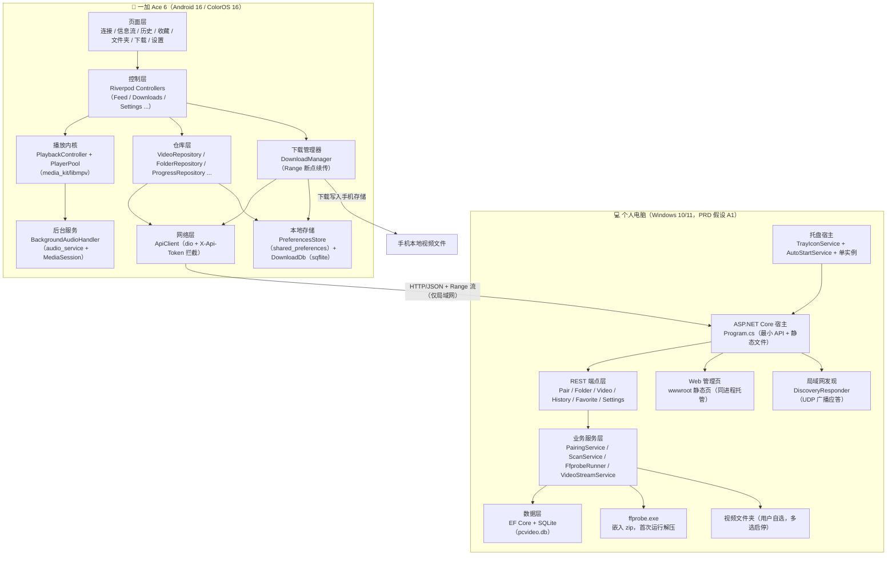
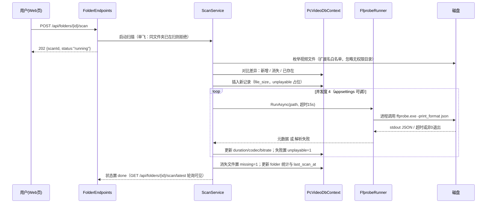
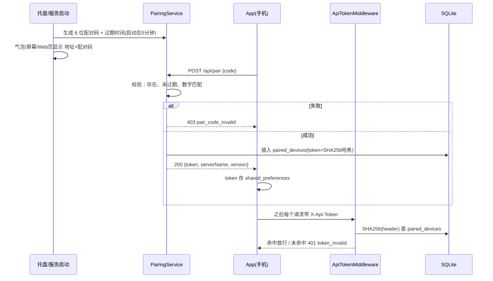
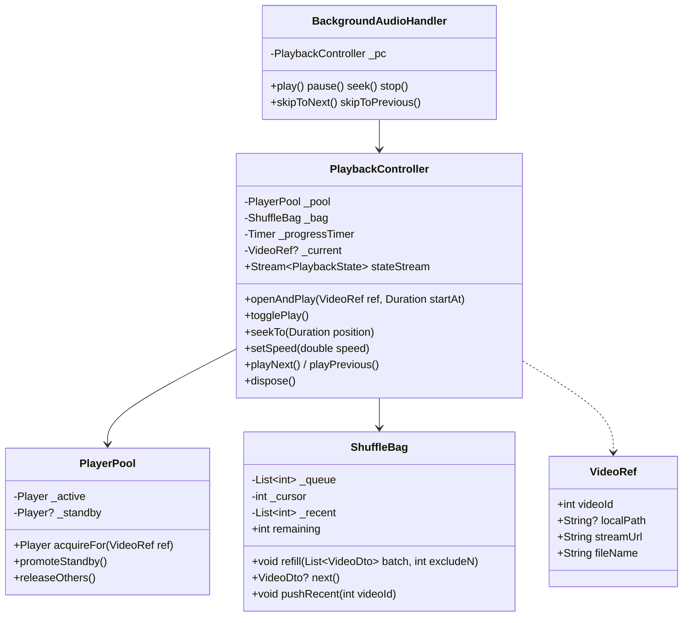
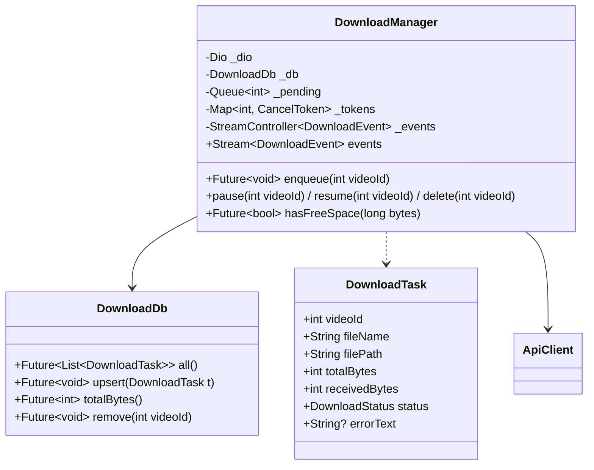
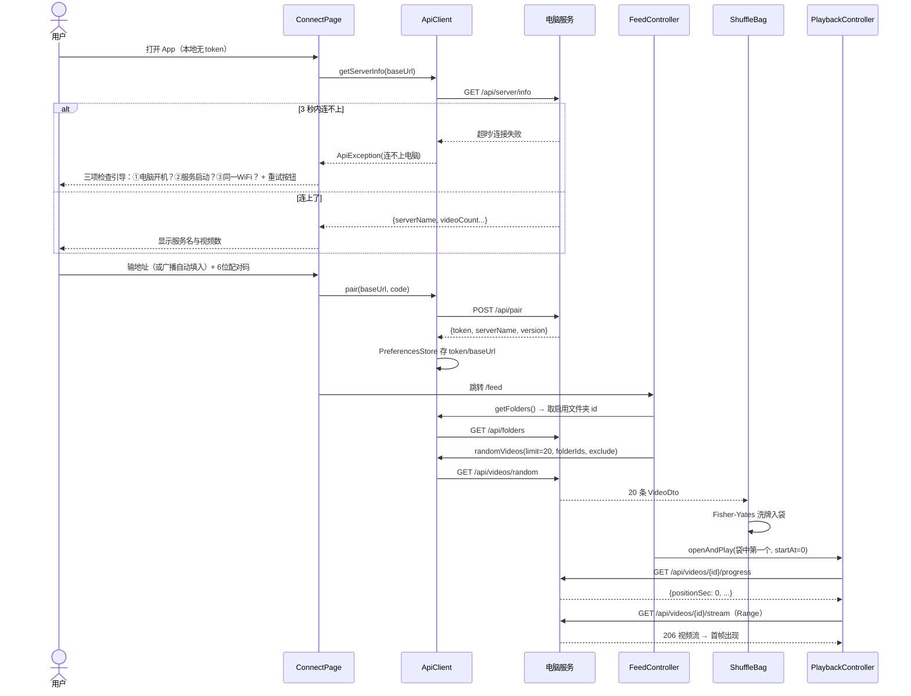
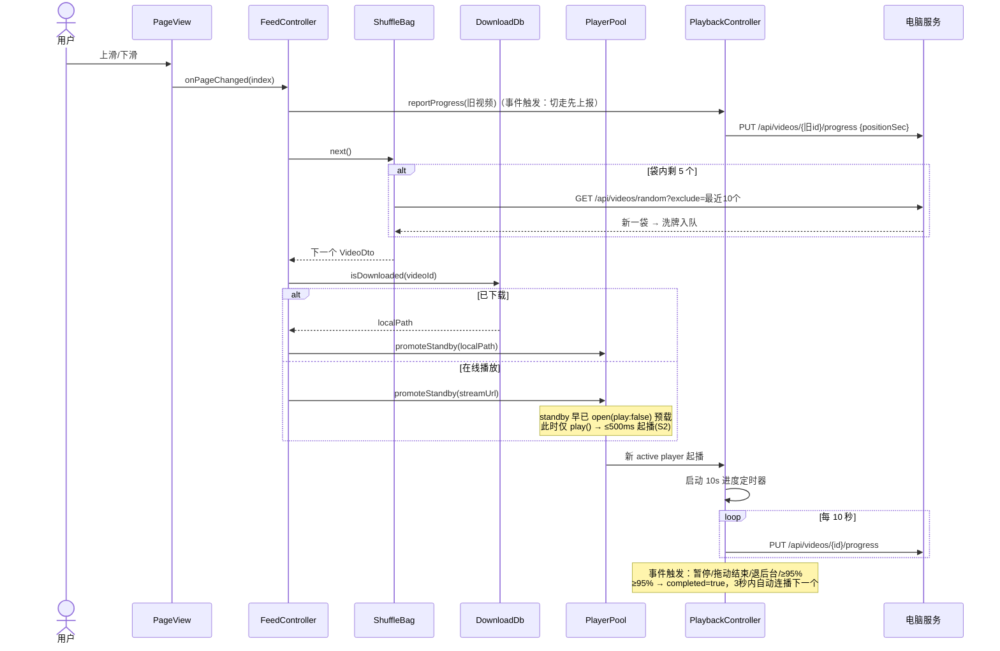
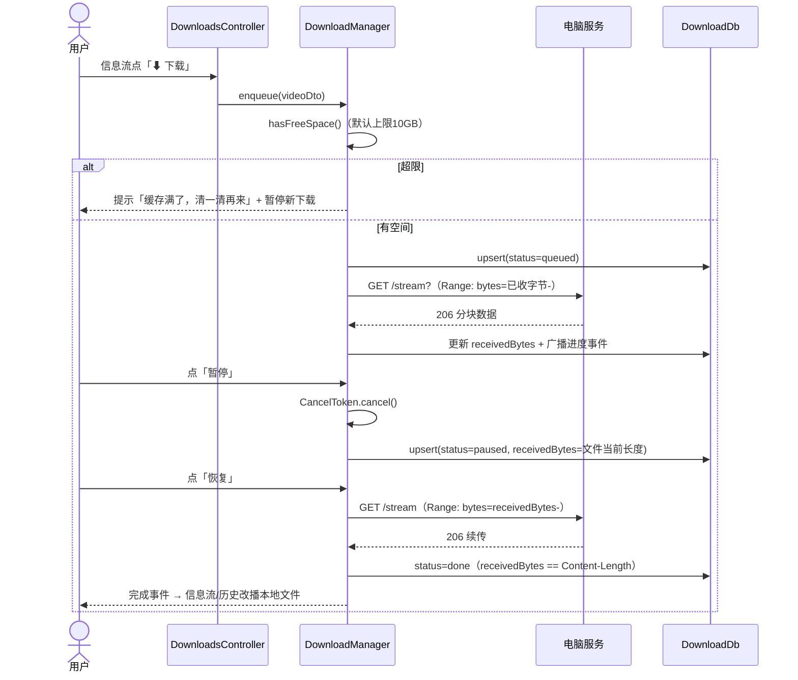
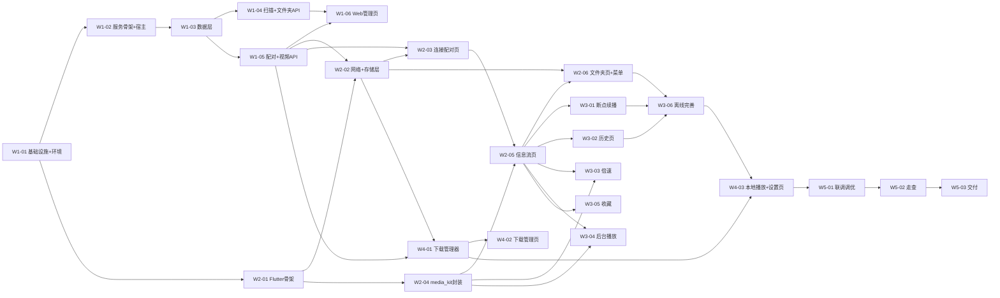

# 《本地刷》架构设计（ARCHITECTURE）

| 项 | 内容 |
| --- | --- |
| 文档版本 | v1.0 |
| 日期 | 2026-10-13 |
| 作者 | 高见远（架构师） |
| 上游输入 | docs/PRD.md v1.1（唯一需求事实源） |
| 项目根目录 | `E:/workbuddy/2026-10-12-23-50-24/pcvideo-app/` |
| 状态 | 待评审 |

本文档在 PRD v1.1 基础上定稿：两端模块划分、数据模型、接口契约、调用流程、任务分解（按 PRD §11 五个 Wave）、依赖包、共享约定、架构决策记录、待明确事项。所有与 PRD 草案不一致之处均在 §4.6「与 PRD 草案差异表」显式列出，未默默修改。

---

## 1. 架构总览

### 1.1 两端模块划分图



### 1.2 模块职责（一句话）

**电脑端**

| 模块 | 职责 |
| --- | --- |
| TrayIconService / AutoStartService | 托盘常驻、开机自启开关（注册表）、单实例保护、启动时气泡展示地址+配对码 |
| REST 端点层 | 最小 API，按资源分文件，统一错误格式（见 §4.5） |
| PairingService / TokenService | 6 位配对码生成与校验（5 分钟有效）、token 签发与校验（SHA256 存储） |
| ScanService + FfprobeRunner | 文件夹扫描入库、ffprobe 取元数据、无法解析标记「可能无法播放」、文件消失标记 |
| VideoStreamService | 基于框架 Range 能力的流式传输（播放与下载同一接口） |
| DiscoveryResponder | 监听 UDP 广播，应答服务名与端口（设备发现辅助，PRD §4.4） |
| Web 管理页 | 同进程托管静态页：文件夹增删/启停/扫描、配对码、无法播放标记、服务状态 |

**手机端**

| 模块 | 职责 |
| --- | --- |
| 页面层 | 7 个页面（见 §3.2），小白口吻文案 |
| 控制层 | Riverpod controllers，串联 UI / 播放 / 网络 / 下载 |
| PlaybackController + PlayerPool | media_kit 播放器生命周期、双实例预加载池、倍速、进度上报触发 |
| BackgroundAudioHandler | 前台服务（mediaPlayback）+ MediaSession 通知，锁屏可控 |
| 仓库层 | 对 ApiClient 的业务语义封装，页面不直接碰 dio |
| ApiClient | baseUrl / token 拦截 / 错误统一映射为 ApiException |
| DownloadManager | 下载队列、Range 断点续传、上限控制、进度事件流 |
| DownloadDb / PreferencesStore | 下载索引 + 本地进度镜像（sqflite）；token/设置（shared_preferences） |

### 1.3 与 PRD 选型的一致性声明

本架构完整继承 PRD §4 全部已定决策，无推翻：

- App：Flutter；播放内核 media_kit（libmpv）（PRD §4.1/§4.2）
- 电脑端：ASP.NET Core 8/9 LTS 自包含单文件 + EF Core + SQLite（PRD §4.3）
- ffprobe.exe 随包分发做元数据扫描（PRD §4.4）
- 服务常驻：开机自启 + 托盘常驻可关闭（PRD §4.4）
- 鉴权：6 位配对码换 token，`X-Api-Token` 头（PRD §4.4）
- 下载复用 `/stream` Range，不新增下载接口（PRD §4.4/§6）
- 不做转码、不做片头片尾跳过、收藏与稍后再看合并、iOS 本期不交付（PRD §1.4/§9）

架构阶段新增/定稿的实现层决策（不影响上述选型）见 §9 架构决策记录，其中扫描接口改异步轮询、文件夹「文件消失标记」、已下载视频本地进度镜像三项是对 PRD 草案的显式补充，理由见 §4.6。

---

## 2. 电脑端服务设计

### 2.1 项目结构（.NET 解决方案布局，相对路径）

```text
pcvideo-app/
├─ docs/                        # 文档（PRD、本架构、ENV、README）
├─ server/
│  ├─ PcVideo.sln
│  ├─ global.json               # 锁定 .NET SDK 版本（可复现构建）
│  ├─ Directory.Packages.props  # 集中包版本管理（锁版本不浮动）
│  ├─ tools/
│  │  └─ ffprobe/
│  │     ├─ ffprobe-win-x64.zip # 约 35MB（估算），不入 Git，见 tools/README.md
│  │     └─ README.md           # 下载地址与放置说明
│  └─ PcVideo.Server/
│     ├─ PcVideo.Server.csproj  # UseWindowsForms=true（托盘）；zip 内嵌为 EmbeddedResource
│     ├─ Program.cs             # 宿主装配：Kestrel / EF / Serilog / 端点映射 / 托盘
│     ├─ appsettings.json       # 端口、扫描并发、配对码 TTL 等（见 §8.5）
│     ├─ Data/
│     │  ├─ PcVideoDbContext.cs
│     │  ├─ Entities/           # FolderEntity / VideoEntity / PlaybackProgressEntity /
│     │  │                      # FavoriteEntity / PairedDeviceEntity / SettingEntity
│     │  └─ Migrations/         # dotnet ef 生成
│     ├─ Endpoints/             # 最小 API，按资源一文件
│     │  ├─ PairEndpoints.cs
│     │  ├─ ServerEndpoints.cs
│     │  ├─ FolderEndpoints.cs
│     │  ├─ VideoEndpoints.cs
│     │  ├─ HistoryEndpoints.cs
│     │  ├─ FavoriteEndpoints.cs
│     │  └─ SettingsEndpoints.cs
│     ├─ Services/
│     │  ├─ PairingService.cs       # 配对码内存态 + 校验
│     │  ├─ TokenService.cs         # token 签发 / SHA256 比对
│     │  ├─ ScanService.cs          # 扫描编排（单飞/并发/状态）
│     │  ├─ FfprobeRunner.cs        # ffprobe 进程调用 + JSON 解析
│     │  ├─ FfprobeProvider.cs      # 首次运行解压内嵌 zip 到本地缓存
│     │  ├─ VideoStreamService.cs   # Range 流式响应
│     │  └─ SettingsService.cs      # settings 表读写 + 缓存
│     ├─ Hosting/
│     │  ├─ TrayIconService.cs      # STA 线程 + NotifyIcon 菜单
│     │  ├─ AutoStartService.cs     # HKCU Run 注册表读写
│     │  ├─ SingleInstanceGuard.cs  # 命名 Mutex
│     │  └─ DiscoveryResponder.cs   # UDP 广播应答
│     └─ wwwroot/
│        ├─ index.html              # Web 管理页
│        ├─ admin.css
│        └─ admin.js
└─ app/                          # Flutter 工程（见 §3.1）
```

**单项目理由**：个人自用工具，分层到多项目只会增加构建与跳转成本；用文件夹按关注点组织（Data/Endpoints/Services/Hosting/wwwroot），发布成一个自包含单文件 exe。若将来要复用域模型（如加 CLI 工具）再拆 `PcVideo.Core`（撤销条件见 ADR-05）。

### 2.2 SQLite 数据模型

```mermaid
erDiagram
    folders ||--o{ videos : "包含"
    videos ||--o| playback_progress : "有播放进度"
    videos ||--o| favorites : "被收藏"
    folders {
        INTEGER id PK
        TEXT path UK "文件夹绝对路径"
        TEXT name "显示名"
        INTEGER enabled "1=参与随机 0=停用"
        INTEGER video_count "启用口径的入库数（冗余）"
        INTEGER unplayable_count "冗余统计"
        TEXT last_scan_at "ISO8601 UTC 可空"
        TEXT created_at "ISO8601 UTC"
    }
    videos {
        INTEGER id PK
        INTEGER folder_id FK
        TEXT file_path UK "文件绝对路径（长路径前缀归一化后）"
        TEXT file_name
        INTEGER file_size "字节"
        REAL duration_sec "可空"
        INTEGER width "可空"
        INTEGER height "可空"
        TEXT video_codec "可空"
        TEXT audio_codec "可空"
        INTEGER bitrate_kbps "可空"
        TEXT container "扩展名小写"
        INTEGER unplayable "1=ffprobe 无法解析"
        INTEGER missing "1=磁盘上暂时找不到（外接盘离线等）"
        TEXT added_at
        TEXT updated_at
    }
    playback_progress {
        INTEGER video_id PK_FK
        REAL position_sec "最近播放位置"
        REAL duration_sec "上报时时长"
        INTEGER completed "1=已看到95%以上"
        TEXT last_played_at "历史排序键"
    }
    favorites {
        INTEGER video_id PK_FK
        TEXT created_at
    }
    paired_devices {
        INTEGER id PK
        TEXT token_hash UK "SHA256，不明文存 token"
        TEXT device_name "配对时客户端上报"
        TEXT created_at
        TEXT last_used_at "可空"
    }
    settings {
        TEXT key PK
        TEXT value "JSON 值"
    }
```

要点：

- **时间一律 ISO 8601 UTC 字符串**存储（`2026-10-13T12:00:00Z`），由服务端 `DateTime.UtcNow` 产生；客户端不做时区假设。
- **索引**：`videos(file_path)` 唯一、`videos(folder_id)`、`playback_progress(last_played_at DESC)`、`favorites(created_at DESC)`、`paired_devices(token_hash)` 唯一。EF Core 迁移中显式建索引。
- **级联删除**：删文件夹 → 其 videos 级联删除 → progress/favorites 级联删除（EF Core SQLite 默认开外键）。`missing=1` 的视频不进随机池、不进列表默认结果，重新扫描到文件后自动清标记。
- **settings 表**存可改默认值：`serverName / defaultSpeed / autoPlayNext / recentExcludeCount / longVideoThresholdSec / downloadLimitGb`（默认值见 §8.5 与 §10.1）。扫描并发、ffprobe 超时等运行参数放 appsettings.json，不暴露给设置 API。
- 数据库文件位置：`%LOCALAPPDATA%\PcVideo\pcvideo.db`（可写、不随单文件 exe 重解压丢失；appsettings 可改）。

### 2.3 ffprobe 扫描流程



- **进程调用**：`Process.Start`，参数 `-v quiet -print_format json -show_format -show_streams "<path>"`；从 `format.duration/bit_rate` 与第一个视频流/第一个音频流取值；取不到视频流或退出码非 0 → `unplayable=1`（前端标「可能无法播放」）。
- **超时**：单文件 15 秒（估算值，appsettings 可调），超时杀进程并标 `unplayable=1`，日志记 warning。超时一般意味着文件损坏或极端码率，不阻塞整库。
- **乱序容错**：扫描是后台作业，服务重启中断后下次扫描自动补齐；DB 以 `file_path` 唯一键幂等，重复扫不会产生重复行；`missing` 标记让「外接盘临时离线」不会被误删数据（PRD R4 的兜底）。
- **Windows 长路径**：超过 260 字符的路径统一加 `\\?\` 前缀再访问（.NET 不默认支持长路径），这是真实片库常见坑，FfprobeRunner 与 VideoStreamService 共用同一个路径归一化工具方法。
- **性能口径**：并发 4 个 ffprobe 进程（估算：家用 CPU 下单个 100ms–500ms），万级库全量扫描约几分钟级（估算）；Web 页轮询进度，不阻塞 HTTP。

### 2.4 Range 流式实现要点

- 端点实现：`GET /api/videos/{id}/stream` → 查 videos 行 → `Results.File(path, contentType, enableRangeProcessing: true)`。206/416/304（If-Range）/Last-Modified 全部由框架处理，不手写字节范围。
- 文件打开用 `FileShare.Read`（播放与下载可同时进行；用户用别的播放器打开同一文件也不会被我们挡）。
- `Content-Type` 按扩展名映射：mp4→`video/mp4`、mkv→`video/x-matroska`、flv→`video/x-flv`、avi→`video/x-msvideo`、ts→`video/mp2t`、wmv→`video/x-ms-wmv`、mov→`video/quicktime`、rmvb→`application/vnd.rn-realmedia-vbr`，未知→`application/octet-stream`。libmpv 自行嗅探，此值主要给 curl/浏览器用。
- 磁盘上找不到文件：返回 404 + `file_missing`，文案「磁盘上找不到这个文件了，去电脑管理页重新扫描试试」。
- 播放与下载走同一接口（PRD 已定）：播放是「顺序 Range 读」，下载是「客户端自己算偏移的 Range 读」，服务端零区分、零新增接口。
- 日志不对每次 Range 请求打 Info（刷一个视频会产生几十条），只打错误；避免日志被刷爆。

### 2.5 配对鉴权流程



- 配对码：启动时生成，托盘菜单可「重新生成」；TTL 5 分钟（PRD §7.2 流程图口径）；纯内存态，重启即失效，不落库。
- token：32 随机字节 base64url；库里只存 SHA256 哈希——库文件被拷贝走也还原不出可用 token。局域网低威胁场景（PRD A6）做到这个程度即可，不做过期/刷新。
- 放行规则：`POST /api/pair` 与 `GET /api/server/info` 公开（连接页要能在配对前探活）；其余 `/api/*` 全部要 token。Web 管理页同源同端口，浏览器里输配对码的场景由页面本身引导，不走 token（个人本机使用，接受此口径；若介意可在设置里加管理页口令，P2）。
- 401 与 403 分工：401 = 没带/带错 token（提示重新配对）；403 = 配对码不对或过期（提示看电脑屏幕）。

### 2.6 托盘 / 开机自启实现方式

- **宿主**：Generic Host（`Host.CreateApplicationBuilder`）+ `UseWindowsService()` 兼容项不启用——本形态是「用户会话级托盘程序」而非系统服务（服务无法弹托盘 UI，PRD 要的是托盘）。
- **托盘**：`<UseWindowsForms>true</UseWindowsForms>`，自包含 Windows 发布自带 Desktop 运行时；专用 STA 线程跑 `Application.Run(TrayApplicationContext)`，`NotifyIcon` 菜单：打开管理页 / 重新生成配对码 / 开机自启（勾选）/ 退出。启动气泡显示 `http://<本机IP>:57821` 与当前配对码（PRD §4.4「把地址和配对码放大显示」的落地）。
- **开机自启**：写 `HKCU\Software\Microsoft\Windows\CurrentVersion\Run`（当前用户，零管理员权限；计划任务需要更高权限，撤销理由见 ADR-07）。托盘菜单勾选态 = 注册表值是否存在。
- **单实例**：命名 Mutex（`Local\PcVideo.Server.SingleInstance`），第二实例直接唤醒托盘气泡后退出。
- **防火墙**：首次监听 `0.0.0.0:57821` 时 Windows 会弹防火墙对话框，README 写放行步骤（PRD §8 已列）。

### 2.7 Web 管理页形态

**决策：同进程托管的 vanilla 静态页（index.html + admin.js + admin.css），无构建步骤、无 npm。**

- 形态：`wwwroot/` 下三个文件，`UseStaticFiles` + `MapFallbackToFile("index.html")` 托管；admin.js 直接 fetch 同源 `/api/*`（天然无 CORS 问题）。
- 内容（对齐 PRD §6 表格最后一行）：服务状态条（名称/版本/视频数/文件夹数/配对码大字 + 重新生成按钮）、文件夹表格（名称/路径/启停开关/视频数/无法播放数/最近扫描/扫描按钮/删除）、添加文件夹表单（路径输入 + 校验错误直显，PRD R4 的「明确报错原因」）、扫描进度轮询展示。
- 理由与备选：Blazor Server 要多背 circuit 与组件模型、React/Vite 要引入前端工具链——个人工具由 C# 开发者维护，一个 300 行以内的 admin.js 是最省心的形态（完整取舍见 ADR-04）。

---

## 3. App 设计

### 3.1 Flutter 工程结构：feature-first

```text
pcvideo-app/app/
├─ pubspec.yaml                  # 依赖锁死精确版本（见 §7.2）
├─ analysis_options.yaml         # flutter_lints，加严格模式开关
├─ lib/
│  ├─ main.dart                  # 初始化：WidgetsFlutterBinding / sqflite / audio_service / ProviderScope
│  ├─ app.dart                   # MaterialApp + 路由 + 主题
│  ├─ core/
│  │  ├─ constants.dart          # 默认值、超时、间隔等唯一来源
│  │  ├─ logger.dart             # dLog：仅 debug 输出，绝不打 token
│  │  ├─ network/
│  │  │  ├─ api_client.dart      # dio 实例、拦截器、全部端点调用
│  │  │  └─ api_exception.dart   # 统一错误类型 + 小白文案映射
│  │  ├─ storage/
│  │  │  ├─ preferences_store.dart  # shared_preferences（token/baseUrl/设置）
│  │  │  └─ download_db.dart        # sqflite：downloads + local_progress 两表
│  │  ├─ data/                   # 跨功能仓库（被多个页面复用）
│  │  │  ├─ video_repository.dart / folder_repository.dart
│  │  │  ├─ progress_repository.dart / history_repository.dart
│  │  │  ├─ favorite_repository.dart / settings_repository.dart
│  │  │  └─ server_repository.dart   # info / pair / 发现
│  │  └─ models/                 # video / folder / server_info / settings / download_task / playback_progress
│  ├─ features/
│  │  ├─ connect/    # connect_page.dart / connect_controller.dart / discovery_service.dart
│  │  ├─ feed/       # feed_page.dart / feed_controller.dart / video_overlay.dart / long_video_dialog.dart / shuffle_bag.dart
│  │  ├─ player/     # playback_controller.dart / player_pool.dart / background_audio_handler.dart / video_surface.dart
│  │  ├─ history/    # history_page.dart / history_controller.dart
│  │  ├─ favorites/  # favorites_page.dart / favorites_controller.dart
│  │  ├─ folders/    # folders_page.dart / folders_controller.dart
│  │  ├─ downloads/  # downloads_page.dart / downloads_controller.dart / download_manager.dart
│  │  └─ settings/   # settings_page.dart / settings_controller.dart / battery_guide_page.dart
│  └─ router/app_router.dart     # 路由表（见 §3.2）
└─ android/app/src/main/AndroidManifest.xml   # 前台服务类型 / 通知权限 / 竖屏锁定
```

**选 feature-first 的理由**：页面与 PRD §7.1 清单一一对应，工程师可以一个功能一条线并行开发（W3 的五个任务几乎不撞文件）；`core/` 收敛跨功能复用物（网络/存储/模型/仓库），避免 layer-first 下「改一个模型穿透六层目录」的巡回修改。页面间共享的只有 Video 模型与仓库，放在 core 后依赖方向单向：`features → core`，features 之间不互相 import（完整取舍见 ADR-03）。

### 3.2 页面清单与路由

| 路由 | 页面 | 文件 | 优先级 |
| --- | --- | --- | --- |
| `/connect` | 连接/配对页（地址 + 配对码 + 三项检查引导） | features/connect/connect_page.dart | P0 |
| `/feed` | 信息流首页（全屏竖屏播放 + 控制层 + 掉线横幅） | features/feed/feed_page.dart | P0 |
| `/history` | 播放历史 | features/history/history_page.dart | P1 |
| `/favorites` | 收藏列表 | features/favorites/favorites_page.dart | P1 |
| `/folders` | 文件夹管理（启停开关） | features/folders/folders_page.dart | P0 |
| `/downloads` | 下载管理 | features/downloads/downloads_page.dart | P1 |
| `/settings` | 设置（倍速默认/连播/缓存上限/重配对/电池引导/关于） | features/settings/settings_page.dart | P1 |

导航规则：App 启动 → 无 token 或 `baseUrl` 为空 → `/connect`；否则 → `/feed`（feed 控制器先探活，失败显示掉线横幅，不跳走）。信息流页左上角「☰」打开功能菜单（底部 sheet）进其余五个页面；信息流页本身竖屏锁定（`SystemChrome.setPreferredOrientations`），其余页面允许竖屏。

### 3.3 状态管理：Riverpod

- **选型**：`flutter_riverpod`（不用 code-gen，不引 build_runner，保持构建简单）。
- **trade-off**：Bloc 事件/状态显式但样板代码对个人项目太重；Provider 太原始，异步初始化与生命周期管理要手写。Riverpod 编译期安全、`ref` 不依赖 BuildContext、异步初始化（`FutureProvider`）自然、控制器可单测。
- **使用口径**：页面级 `ConsumerWidget`；跨页面长生命对象（PlaybackController、DownloadManager、ApiClient）用全局 `Provider` 常驻；列表数据用 `AsyncNotifier`/`FutureProvider`；下载进度用 `StreamProvider` 订阅 DownloadManager 事件流。

### 3.4 本地存储选型

| 数据 | 方案 | 理由 |
| --- | --- | --- |
| token / baseUrl / 设置项（倍速、连播、上限等） | shared_preferences | 简单 KV；token 威胁模型是「同 WiFi 误连」（PRD A6），不需要 Keystore；介意可在设置里换 flutter_secure_storage（ADR-02 备选） |
| 下载索引（downloads 表） | sqflite | 需要按状态查询/排序/统计总量，KV 不够 |
| 本地进度镜像（local_progress 表） | sqflite | 断网播放已下载视频时记进度，联网后补报服务端（F-12 的隐含需求，见 §4.6 差异 4） |

播放历史/收藏/进度**服务端为唯一事实源**（PRD §6 一致性说明）；本地镜像只服务「已下载视频的离线播放」场景，联网即以服务端为准。

### 3.5 播放器封装（media_kit）



- **生命周期**：`PlaybackController` 是全局单例（Riverpod 常驻 Provider），`PlayerPool` 最多持有 2 个 `media_kit.Player`：active（当前页）+ standby（预加载下一集）。滑走时 standby 提升为 active，旧 active 释放（`player.dispose()`），再为下一集准备新 standby。上限 2 个实例是内存与预加载效果的折中（估算：1080p 软解每实例约 150–300MB，Ace 6 内存充足；真机实测后可在 PlayerPool 调）。
- **预加载策略**：当前视频起播后即用 standby `open(media, play: false)` 预载下一集——libmpv 会完成解封装与首段缓冲但不渲染不播音；滑动到位后 `play()`，目标 S2 ≤500ms 起播。下载完成的视频预载本地文件，几乎瞬时。
- **洗牌袋算法**（PRD §7.3 落地）：`GET /api/videos/random?limit=20&folderIds=<启用>&exclude=<最近N个>` → Fisher–Yates 洗牌入袋；袋内不重复；剩 5 个时静默预取下一袋（exclude 最近 N=10，可设）；池 <20 时退化为全量循环洗牌；播过的 id 进 `_recent` 供 exclude。本地另维护会话导航栈支撑通知栏「上一条/下一条」（随机流没有服务端意义上的上一条，见 §4.6 差异 6）。
- **起播前查本地**：`openAndPlay` 先查 `DownloadDb` 有无本地文件：有 → `VideoRef.localPath` 直接播文件；无 → `streamUrl` 走网络。
- **进度上报双触发**：播放中每 10s 定时触发 + 事件触发（暂停、拖动结束、切走、退后台/息屏、≥95%、前台恢复）；同视频最小间隔 2s；失败静默（见 §4.5 详细规则）。
- **混合码率缓冲**：起播小缓冲求快、播放中 libmpv 自适应扩容；弱网不无限转圈——10s 无进展给出「网不太好」浮层 + 重试按钮（PRD §8）。

### 3.6 后台播放服务与通知

- `audio_service` + `BackgroundAudioHandler`（`BaseAudioHandler`）封装 PlaybackController；Android 端由 `AudioServiceActivity` 承载，manifest 声明：
  - `<service android:name="com.ryanheise.audioservice.AudioService" android:foregroundServiceType="mediaPlayback" android:exported="false" />`
  - 权限：`FOREGROUND_SERVICE`、`FOREGROUND_SERVICE_MEDIA_PLAYBACK`（API 34+ 必需）、`POST_NOTIFICATIONS`（API 33+ 运行时请求，首次播放时用 permission_handler 申请，拒绝则通知不可见但播放继续）。
  - `WAKE_LOCK`（media_kit/audio_service 需要）。
- 通知栏/锁屏：播放暂停、上一条/下一条（走本地导航栈）、进度条（MediaSession）。
- ColorOS 16 电池优化引导：设置页「怎么让锁屏不断播」引导页，图文 + 手动路径文案，deep link 失败退手动（PRD §8）。
- 165Hz：`flutter_displaymode` 在 W5-01 接入请求高刷档位；注意 Impeller 与 media_kit Texture 的兼容风险（见 §11 风险点）。

### 3.7 下载管理器



- **队列**：`pending` 队列 + 并发 2（估算：家用 WiFi 下单任务跑满带宽时并发 2 足够，且不拖垮播放）；暂停 = `CancelToken.cancel()` + 落盘已收字节；恢复 = 发起 `Range: bytes=received-` 的新请求，追加写文件。
- **上限**：默认 10GB（PRD A7，设置页可改）；入队前 `hasFreeSpace` 校验，超限暂停新下载并提示「缓存满了，先去下载管理页清一清」。
- **完成校验**：`receivedBytes == Content-Length`（或服务端 416 表示已到末尾）才算完成；完成后写入 `downloads` 表状态，信息流/历史改播本地文件。
- **事件**：进度/状态变化走广播 Stream，下载页与信息流角标共用订阅。

### 3.8 网络层（dio）

- `ApiClient` 持 `Dio`：`BaseOptions(baseUrl: 运行时取自 PreferencesStore, connectTimeout: 5s, receiveTimeout: 30s, responseType: json)`。baseUrl 形如 `http://192.168.1.23:57821`（配对时存入）。
- **拦截器**：`TokenInterceptor` 给每个请求加 `X-Api-Token`；`ErrorInterceptor` 把 `DioException` 归一为 `ApiException{code, message}`——401 → 「和电脑的配对过期了，去设置里重新配对」；超时/连接失败 → 「连不上电脑」；5xx → 「电脑服务出错了」；文案集中在 api_exception.dart 一处维护。
- **不做**：全局自动重试（GET 幂等接口最多 1 次重试，进度上报类直接失败静默）；不做 CORS 配置（原生 App 无此问题，Web 页同源）。
- **发现**：`DiscoveryService` 启动时向 `255.255.255.255:57822` 发 UDP 广播，服务端 `DiscoveryResponder` 回 `{name, port}`，自动填地址（PRD §4.4 辅助手段；失败就手动输，P1 项，ColorOS 上 UDP 广播在部分路由器被禁，属已知限制）。

---

## 4. 接口契约定稿

### 4.1 通用约定

- Base URL：`http://<电脑IP>:57821`（默认端口，appsettings 可改）。
- 鉴权：除 `POST /api/pair`、`GET /api/server/info` 外，全部请求带 `X-Api-Token` 头。
- **成功响应不包信封**，直接返回资源 JSON（个人工具少一层包装，前端少一层解包）。
- **错误响应统一格式**：

```json
{ "code": "pair_code_invalid", "message": "配对码不对或过期了，看看电脑屏幕上的数字" }
```

- 时间字段一律 ISO 8601 UTC 字符串。
- 分页统一 keyset cursor：客户端把返回的 `nextCursor` 原样带回，`null` 表示没有下一页。

### 4.2 端点定义

#### 配对与服务器信息

`POST /api/pair`（公开）
- 请求：`{ "code": "123456", "deviceName": "一加 Ace 6" }`
- 200：`{ "token": "bXl0b2tlbg...", "serverName": "我的电脑", "version": "1.0.0" }`
- 400 `invalid_request` / 403 `pair_code_invalid`（5 分钟有效）

`GET /api/server/info`（公开）
- 200：`{ "serverName": "我的电脑", "version": "1.0.0", "videoCount": 3421, "folderCount": 5, "enabledFolderCount": 4 }`

#### 文件夹

`GET /api/folders` → 200：`[{ "id": 3, "name": "电视剧", "path": "D:\\Video\\TV", "enabled": true, "videoCount": 128, "unplayableCount": 2, "missingCount": 0, "lastScanAt": "2026-10-13T12:00:00Z", "createdAt": "..." }]`

`POST /api/folders`
- 请求：`{ "path": "D:\\Video\\TV", "name": "电视剧" }`（name 可空，空则取目录名）
- 201：FolderDto；400 `invalid_request`（路径不存在/不是目录）；409 `folder_already_exists`

`DELETE /api/folders/{id}` → 204（不删磁盘文件；其视频/进度/收藏级联删除）

`PUT /api/folders/{id}/enabled`
- 请求：`{ "enabled": false }`；200：FolderDto（随机池口径随之变化）

`POST /api/folders/{id}/scan`
- 202：`{ "scanId": "3f2a...", "status": "running", "startedAt": "..." }`；正在扫描中 → 409 `scan_in_progress`

`GET /api/folders/{id}/scan/latest`
- 200：`{ "status": "done", "found": 128, "added": 3, "removed": 1, "unplayable": 2, "startedAt": "...", "finishedAt": "...", "error": null }`（status: running/done/failed）

#### 视频

VideoDto：
```json
{
  "id": 12, "folderId": 3, "folderName": "电视剧",
  "fileName": "甄嬛传.S01E01.mkv", "fileSize": 1234567890,
  "durationSec": 2640.5, "width": 1920, "height": 1080,
  "videoCodec": "h264", "audioCodec": "aac", "bitrateKbps": 4500,
  "unplayable": false, "addedAt": "2026-10-13T12:00:00Z"
}
```

`GET /api/videos?folderId=&enabledOnly=&cursor=&limit=20`
- 200：`{ "items": [VideoDto], "nextCursor": "20" }`（默认排除 missing；管理场景可传 `includeMissing=true`）

`GET /api/videos/random?limit=20&folderIds=1,3,5&exclude=8,9,10`
- limit 默认 20 最大 50；folderIds 不传 = 全部启用文件夹；exclude 逗号分隔最多 50 个 id
- 200：`{ "items": [VideoDto], "poolSize": 3421 }`（poolSize 供客户端做「小片库退化」判断）

`GET /api/videos/{id}/stream`
- Range 流式（§2.4）；200/206；视频记录不存在 404 `not_found`；磁盘文件不存在 404 `file_missing`

`GET /api/videos/{id}/progress`
- 200：`{ "positionSec": 0, "durationSec": 2640.5, "completed": true }`（无记录时返回 0/false；completed=true 时 positionSec 返回 0 —— 看完重刷规则）

`PUT /api/videos/{id}/progress`
- 请求：`{ "positionSec": 123.4, "durationSec": 2640.5, "completed": false }`
- 服务端规则：`positionSec >= 0.95 * durationSec`（durationSec>0）或客户端显式 `completed=true` → 标 completed；completed 粘滞：只有收到 `completed=false` 且 `positionSec < 0.5*durationSec` 才解除
- 200：`{ "positionSec": 123.4, "completed": false }`

#### 历史

`GET /api/history?cursor=&limit=50`
- 200：`{ "items": [{ "video": VideoDto, "positionSec": 1234.0, "durationSec": 2640.5, "completed": false, "lastPlayedAt": "..." }], "nextCursor": null }`（按 lastPlayedAt 倒序）

`DELETE /api/history/{videoId}` → 204；`DELETE /api/history` → 204（清空）

#### 收藏

`PUT /api/videos/{id}/favorite` 请求 `{ "isFavorite": true }` → 200：`{ "isFavorite": true }`（幂等 upsert/delete）
`GET /api/favorites?cursor=&limit=50` → 200：`{ "items": [{ "video": VideoDto, "favoritedAt": "..." }], "nextCursor": null }`

#### 设置

`GET /api/settings` → 200：`{ "serverName": "我的电脑", "defaultSpeed": 1.0, "autoPlayNext": true, "recentExcludeCount": 10, "longVideoThresholdSec": 1800, "downloadLimitGb": 10 }`
`PUT /api/settings` 请求为上面 JSON 的子集（部分更新合并）→ 200：合并后完整对象

### 4.3 状态码与错误码表

| HTTP | code | message（小白文案） | 场景 |
| --- | --- | --- | --- |
| 200/201/204 | — | — | 成功 |
| 400 | invalid_request | 请求内容不对 | 参数缺失/路径不存在 |
| 401 | token_invalid | 和电脑的配对过期了，去设置里重新配对 | 缺/错 X-Api-Token |
| 403 | pair_code_invalid | 配对码不对或过期了，看看电脑屏幕上的数字 | 配对失败 |
| 404 | not_found | 没找到这个东西 | 资源 id 不存在 |
| 404 | file_missing | 磁盘上找不到这个文件了，去电脑管理页重新扫描试试 | 流式时文件没了 |
| 409 | folder_already_exists | 这个文件夹已经加过了 | 重复添加 |
| 409 | scan_in_progress | 正在扫描中，稍等一下 | 重复触发扫描 |
| 500 | server_error | 电脑服务出错了，详情看服务日志 | 未处理异常 |
| 206/416/304 | — | — | Range 流式（框架处理） |

### 4.4 播放进度上报：双触发设计（PRD R7 定稿）

- **时间触发**：播放中每 10 秒上报一次 `{positionSec, durationSec}`。
- **事件触发**（不等定时器）：① 用户暂停/继续；② 拖动进度条结束；③ 切走当前视频（先报旧视频再播新的，保证续播点新鲜）；④ App 退后台/息屏；⑤ 检测到 ≥95%（报 `completed=true`）；⑥ 从后台恢复前台。
- **节流**：同一视频两次上报最小间隔 2 秒（估算值，`core/constants.dart` 可调）；上报失败一律静默丢弃，不弹错、不入重试队列——下一次上报会覆盖。
- **离线已下载视频**：进度写本地 `local_progress`；恢复联网后由 ProgressRepository 补报服务端（W3-06）。
- **服务端**：last-write-wins upsert；completed 规则见 §4.2。

### 4.5 与 PRD 草案差异表（显式修订建议）

| # | PRD 草案 | 架构定稿 | 理由 |
| --- | --- | --- | --- |
| 1 | §6 random「exclude=最近播放id」 | exclude=逗号分隔 id 列表，最多 50 | 洗牌袋要排除最近 N=10 个，单个 id 不够 |
| 2 | §6 POST scan 同步返回统计 | 202 + `GET .../scan/latest` 轮询 | 万级库扫描数分钟，HTTP 同步阻塞不可接受；返回字段保持 PRD 的 {found, added, removed, unplayable, status} |
| 3 | §6 POST /api/folders 未写响应体 | 201 返回 FolderDto | 与列表结构一致，前端少猜 |
| 4 | F-12「断 WiFi 也能从信息流/历史播该视频」 | 增加本地进度镜像 + 下载索引合并展示 | PRD 隐含但未展开：没有本地镜像，断网点进历史/信息流播已下载视频时进度与历史为空。属补充非矛盾 |
| 5 | §7.1④「增删引导去 Web」vs F-04④「App 与 Web 均可改启停」 | 定稿：**启停两端可改，增删仅 Web 页** | PRD 两处实为一致（一个说增删、一个说启停），定稿写明消除歧义，非修改 |
| 6 | F-11 锁屏「上一条/下一条」 | 本地会话导航栈回放，非服务端「上一个文件」 | 随机流没有绝对的上一集概念；定稿为「袋内回退」 |
| 7 | §6 random 未写响应包裹 | `{items, poolSize}` | 客户端需要池大小做小片库退化判断 |
| 8 | F-10 倍速跨视频保持 vs 服务端 defaultSpeed | 客户端会话值优先；服务端设置为新设备/新会话默认 | 两端都有默认值时定稿优先级，避免「改了没生效」 |

以上 8 条建议产品经理评审确认；如不接受，按 PRD 原文实现并在代码注释标明。

---

## 5. 程序调用流程（时序图）

### 5.1 首次配对 → 进入信息流



### 5.2 滑动切换视频（含预加载与进度上报）



### 5.3 下载断点续传



### 5.4 服务端扫描（ffprobe）

见 §2.3 时序图（扫描编排、并发、超时、missing 标记全流程）。

---

## 6. 任务列表（按 Wave，有序、含依赖）

> 对齐 PRD §11 五个 Wave。每个任务原子化到工程师可批量执行；任务按模块分组（非一文件一任务）；标注「可并行」的任务在依赖满足后可与同 Wave 其他任务同时开工。

### Wave 1：环境 + 电脑端服务

| ID | 名称 | 涉及文件/目录 | 依赖 | 可并行 | 完成验收标准 |
| --- | --- | --- | --- | --- | --- |
| W1-01 | 项目基础设施与环境准备 | `.gitignore`、`README.md`（骨架）、`docs/ENV.md` | — | 否（首个） | ① 工具链按 docs/ENV.md 装齐并验证：`dotnet --info` 9.x、`flutter doctor` 全绿、Android SDK Platform 36 就绪；② git 仓库初始化、忽略项生效；③ ENV.md 记录实际安装版本 |
| W1-02 | 服务骨架与宿主（含发现应答） | `server/PcVideo.sln`、`global.json`、`Directory.Packages.props`、`PcVideo.Server/`（csproj、`Program.cs`、`appsettings.json`）、`Hosting/`（TrayIconService、AutoStartService、SingleInstanceGuard、DiscoveryResponder）、`Endpoints/ServerEndpoints.cs` | W1-01 | 否 | ① `dotnet run` 起服务，`curl localhost:57821/api/server/info` 200；② 托盘图标+菜单（打开管理页/重新生成配对码/开机自启勾选/退出）可用；③ 注销重登后服务自启；④ 单实例；⑤ UDP 广播有应答 |
| W1-03 | 数据层（EF Core + SQLite） | `Data/Entities/*.cs`（6 个）、`Data/PcVideoDbContext.cs`、`Data/Migrations/`、Program.cs 注册 DbContext | W1-02 | 否 | ① `dotnet ef migrations add InitialCreate` 生成并应用；② 六张表+约定索引建成；③ 库文件落在 `%LOCALAPPDATA%\PcVideo\pcvideo.db`；④ 删文件夹级联删除验证通过 |
| W1-04 | ffprobe 扫描器 + 文件夹 API | `Services/FfprobeProvider.cs`、`FfprobeRunner.cs`、`ScanService.cs`、`Endpoints/FolderEndpoints.cs`、`tools/ffprobe/`（zip+README）、csproj 内嵌资源配置 | W1-03 | **是**（与 W1-05 并行） | ① 首次运行自动解压 ffprobe 并成功调用；② 加文件夹→201，重复→409，删→204，启停→200；③ 扫描→202，轮询到 done，元数据（时长/分辨率/编码/码率）入库；④ 损坏文件标 unplayable；⑤ 拔掉外接盘再扫标 missing 不删数据；⑥ 超长路径文件不炸 |
| W1-05 | 配对鉴权 + 视频/流式/进度/历史/收藏/设置 API | `Services/PairingService.cs`、`TokenService.cs`、`VideoStreamService.cs`、`SettingsService.cs`、`Middleware/ApiTokenMiddleware.cs`、`Endpoints/`（Pair/Video/History/Favorite/Settings）、appsettings 配对码 TTL | W1-03 | **是**（与 W1-04 并行） | ① 无 token 请求 `/api/videos` 401；② 配对 5 分钟有效、错误码 403；③ `curl -r 100-200` 返回 206 正确字节段（F-07）；④ 进度 upsert + ≥95% 判 completed + 看完返回 positionSec=0；⑤ 历史倒序/删除；⑥ 收藏幂等切换；⑦ settings GET/PUT 合并 |
| W1-06 | Web 管理页 | `PcVideo.Server/wwwroot/`（index.html、admin.css、admin.js）、托盘菜单补全 | W1-04, W1-05 | 否 | ① 浏览器开 `http://localhost:57821` 见状态条+配对码大字；② 文件夹增删/启停/扫描全流程可用，扫描轮询进度可见；③ unplayable 有「可能无法播放」标记；④ 扫描错误（路径不存在/无权限）页面直显原因 |

### Wave 2：App 骨架 + 信息流播放

| ID | 名称 | 涉及文件/目录 | 依赖 | 可并行 | 完成验收标准 |
| --- | --- | --- | --- | --- | --- |
| W2-01 | Flutter 工程骨架 | `app/pubspec.yaml`、`analysis_options.yaml`、`lib/main.dart`、`lib/app.dart`、`lib/router/app_router.dart`、`lib/core/constants.dart`、`lib/core/logger.dart`、`android/app/src/main/AndroidManifest.xml`（竖屏+权限基线）、包名/图标 | W1-01 | 否 | ① `flutter run` 到 Ace 6 起占位页；② 七个路由占位可跳转；③ 竖屏锁定生效；④ pubspec.lock 提交 |
| W2-02 | 网络层 + 本地存储层 | `lib/core/network/`（api_client、api_exception）、`lib/core/storage/`（preferences_store、download_db）、`lib/core/models/*.dart`、`lib/core/data/*_repository.dart`（6 个仓库） | W2-01, W1-05 | 否 | ① token 拦截+错误中文映射单测覆盖主要分支；② sqflite 建 downloads/local_progress 两表；③ 六个仓库对着 W1-05 真服务全方法跑通（配对→随机→进度→历史→收藏→设置） |
| W2-03 | 连接配对页 + 离线引导初版 | `features/connect/`（connect_page、connect_controller、discovery_service） | W2-02, W1-05 | 否 | ① 手动输地址+码配对成功并存 token，重启 App 免配对（F-05）；② info 拉取失败显示三项检查引导+重试（F-20 初版）；③ UDP 广播自动填地址在一加 Ace 6 实测（不可用则记录，退手动） |
| W2-04 | media_kit 封装与 spike | `features/player/`（playback_controller、player_pool、video_surface）、R6 结论记录 | W2-01 | **是**（与 W2-02/W2-03 并行） | ① 本地 mp4/mkv/rmvb 各一播放正常；② 播放/暂停/seek/倍速正常；③ 双 player 池 standby 预载本地文件起播 <500ms；④ APK 体积增量实测记录（R6）；⑤ Impeller 兼容性记录 |
| W2-05 | 信息流页 + 洗牌袋 + 控制条 | `features/feed/`（feed_page、feed_controller、video_overlay、shuffle_bag、long_video_dialog 占位） | W2-03, W2-04 | 否 | ① 竖屏全屏一屏一个；② 连续滑 20 次不崩不黑屏且不重复（F-02）；③ 袋剩 5 静默预取；④ 播到片尾 3 秒内自动连播（F-03）；⑤ 暂停/进度条拖动/时长准确（F-06）；⑥ 抽测切换 ≤500ms 起播（S2）；⑦ 停用文件夹的视频不进池（F-04④） |
| W2-06 | 文件夹管理页 + 功能菜单 | `features/folders/`、`lib/core/widgets/app_menu_sheet.dart`、路由更新 | W2-05, W2-02 | 否 | ① 列表展示电脑文件夹+启停开关；② 停一个文件夹后信息流随机池立即变化（拉新 random 带 folderIds）；③ 菜单可进历史/收藏/下载/设置 |

### Wave 3：P1 播放体验

| ID | 名称 | 涉及文件/目录 | 依赖 | 可并行 | 完成验收标准 |
| --- | --- | --- | --- | --- | --- |
| W3-01 | 断点续播 + 长视频提示 | `features/feed/long_video_dialog.dart`、feed_controller/progress_repository 改造 | W2-05 | **是** | ① 看到一半退出重进续播误差 ≤2s（S3）；② ≥95% 标看完且下次从 0（F-08）；③ 时长 ≥30min 且 progress>0 弹「继续看 mm:ss / 重头看」 |
| W3-02 | 播放历史页 | `features/history/`（history_page、history_controller） | W2-05 | **是** | ① 倒序列表含进度与「看完」标记；② 点击续播；③ 单条/全部删除（F-09） |
| W3-03 | 倍速 5 档 | `features/player/`（速度控制）、video_overlay 速度选择 UI | W2-04, W2-05 | **是** | ① 0.5/1.0/1.25/1.5/2.0 切换生效且声音连续；② 跨视频保持；③ 默认值取设置 defaultSpeed（F-10） |
| W3-04 | 后台播放 + 通知 + 电池引导 | `features/player/background_audio_handler.dart`、main.dart 初始化、`AndroidManifest.xml`（服务类型/权限）、`features/settings/battery_guide_page.dart` | W2-04, W2-05 | **是** | ① 锁屏 5 分钟音频不断；② 通知栏播放暂停+上一条/下一条；③ POST_NOTIFICATIONS 运行时申请；④ 白名单引导页可演示（F-11） |
| W3-05 | 收藏（按钮+列表） | `features/favorites/`、video_overlay 收藏按钮 | W2-05 | **是** | ① 信息流收藏/取消；② 列表展示/取消/点击续播；③ 服务重启后保留（F-13） |
| W3-06 | 离线引导完善 + 本地进度镜像 | download_db（local_progress）、feed/history 合并逻辑、connect 重试流程 | W3-01, W3-02, W2-06 | 否 | ① 电脑睡眠→信息流掉线横幅+重试，恢复后继续刷（F-20）；② 已下载视频断网可播且进度本地记录；③ 联网后补报服务端、以服务端为准 |

### Wave 4：下载缓存

| ID | 名称 | 涉及文件/目录 | 依赖 | 可并行 | 完成验收标准 |
| --- | --- | --- | --- | --- | --- |
| W4-01 | 下载管理器 | `features/downloads/download_manager.dart`、`lib/core/models/download_task.dart`、download_db 扩展 | W2-02, W1-05 | 否 | ① 入队/暂停/恢复/删除全流程；② Range 续传字节连续（暂停点续传后总大小一致、可正常播放验证）；③ 默认上限 10GB，超限暂停新下载并提示；④ 进度事件流稳定 |
| W4-02 | 下载管理页 | `features/downloads/downloads_page.dart`、downloads_controller.dart | W4-01 | **是**（与 W4-03 并行） | ① 下载中/已完成分栏+进度条；② 暂停/恢复/删除；③ 缓存总大小与上限显示（F-12①） |
| W4-03 | 本地播放接入 + 设置页 | feed_controller（下载优先本地路径）、`features/settings/`（settings_page、settings_controller、缓存清理） | W4-01, W3-06 | **是**（与 W4-02 并行） | ① 飞行模式播已下载视频（F-12②）；② 设置页可改默认倍速/自动连播/缓存上限/清理缓存；③ 上限修改对新下载立即生效 |

### Wave 5：联调 + 适配调优 + 交付

| ID | 名称 | 涉及文件/目录 | 依赖 | 可并行 | 完成验收标准 |
| --- | --- | --- | --- | --- | --- |
| W5-01 | 联调与性能调优 | player_pool 缓冲参数、PageView 性能、`flutter_displaymode` 接入、`docs/PERF.md`（实测记录） | W4-03 | 否 | ① S1/S2/S3/S4 实测记录在案；② 165Hz 滑动无持续掉帧；③ 弱网不卡死、有明确错误与重试；④ 万级库随机接口响应实测（R2，超预期改随机 id 区间取样） |
| W5-02 | 边界异常 + 文案 + 注释走查 | 全量代码走查（异常路径、小白口吻文案、注释规范，见 §8） | W5-01 | 否 | ① 异常路径清单（断网/服务重启/文件消失/存储不足/权限拒绝）逐条过；② 文案与注释走查通过；③ 无平台锁死检查预扫 |
| W5-03 | 交付 | `README.md`（完整）、`android/key.properties`（不入库）、签名配置、`docs/iOS-READINESS.md` | W5-02 | 否 | ① 用户按 README 10 分钟内完成启动→配对→播放（S5）；② 交付源码+签名 APK；③ iOS 就绪度检查记录（无 Android 专有硬编码、依赖无平台锁死） |

### 6.1 任务依赖图



**关键并行点**：① W1-04 ∥ W1-05（数据层完成后两端 API 可并行开发）；② W2-04 ∥ W2-02/W2-03（播放器 spike 不依赖网络层）；③ W3-01/02/03/04/05 五路并行（信息流页完成后）；④ W4-02 ∥ W4-03。

---

## 7. 依赖包列表

### 7.1 电脑端 NuGet（锁版本不浮动）

集中版本管理 `server/Directory.Packages.props`，**全部写精确版本，禁止 `^`/`*` 浮动**；SDK 用 `global.json` 锁定。理由：个人工具长期存活靠「半年后还能原样构建」，浮动版本是复现性头号杀手。

| 包 | 版本策略 | 用途 |
| --- | --- | --- |
| `Microsoft.EntityFrameworkCore.Sqlite` | 精确（如 9.0.0，与 SDK 同代 LTS） | SQLite 提供器 |
| `Microsoft.EntityFrameworkCore.Design` | 同上，`PrivateAssets=all` | 迁移工具 |
| `Microsoft.Extensions.Hosting` | 随 Web SDK 隐式带入，不显式引 | 通用宿主 |
| `Serilog.AspNetCore` | 精确 | 结构化日志宿主集成 |
| `Serilog.Sinks.File` | 精确 | 滚动文件日志 |
| WinForms（`<UseWindowsForms>true</UseWindowsForms>` + `FrameworkReference Microsoft.WindowsDesktop.App`） | 框架引用 | 托盘 NotifyIcon |

- `global.json` 锁定 SDK（如 `9.0.1xx`，安装时记入 docs/ENV.md）。
- 评估过未采用：Swashbuckle（最小 API + 个人工具，OpenAPI 是负担）、Dapper（EF Core 对个人更熟，PRD §4.3）。

### 7.2 Flutter pub 依赖（锁版本）

`app/pubspec.yaml` 写精确版本，**提交 pubspec.lock**（应用类工程必须提交，与库相反）。升级原则：一次只升一个包、升完跑一遍信息流+下载冒烟、在 git 记一句原因。

| 包 | 版本策略 | 用途 |
| --- | --- | --- |
| `flutter_riverpod` | 精确（2.x） | 状态管理（§3.3） |
| `media_kit` + `media_kit_libs_video` | 精确（1.x） | libmpv 播放内核（含 Android 预编译库，无需 NDK） |
| `audio_service` | 精确（0.18.x） | 前台服务 + MediaSession 通知 |
| `dio` | 精确（5.x） | HTTP + Range 下载 |
| `shared_preferences` | 精确（2.x） | token/设置 KV |
| `sqflite` | 精确（2.x） | 下载索引/本地进度 |
| `path_provider` | 精确（2.x） | 应用目录定位 |
| `permission_handler` | 精确 | POST_NOTIFICATIONS 等运行时权限 |
| `intl` | 精确 | 时长格式化（mm:ss / h:mm:ss） |
| `flutter_displaymode` | 精确 | W5-01 165Hz 高刷请求（P1 验证项） |
| dev: `flutter_lints`、`flutter_test` | 精确 | 静态检查/单测 |

评估过未采用：connectivity_plus（用 API 探活失败判定离线更准，少一个插件少一个坑）、hive/isar（KV+SQL 已有方案覆盖，少一个存储引擎少一份心智）、riverpod_generator（build_runner 增加构建复杂度，手写 Provider 对个人项目够用）。

### 7.3 ffprobe 来源与分发

- 来源：FFmpeg 官方构建的 Windows 静态版（gyan.dev / ffmpeg.org 的 Windows builds 二选一，安装时记入 `server/tools/ffprobe/README.md`，只取 `ffprobe.exe` 及同批 DLL）。
- 分发：打成 `ffprobe-win-x64.zip`（约 35MB，估算）放 `server/tools/ffprobe/`，**不入 Git**（仓库瘦身）；csproj 以 `EmbeddedResource` 条件包含（zip 存在时才编入）。服务首次启动由 `FfprobeProvider` 解压到 `%LOCALAPPDATA%\PcVideo\bin\ffprobe-<版本>/`，之后进程调用本地解压产物。
- 备选（撤销条件）：若内嵌解压在一加/某环境下出问题，退化为「发布 zip 内 exe 与 ffprobe 文件夹并列」，双击仍可用（ADR-06）。

### 7.4 Windows 开发机环境准备（工程师第一步）

1. .NET SDK 9 LTS（`global.json` 锁定版本）；`dotnet --info` 验证。
2. Flutter stable SDK（安装时记录版本到 docs/ENV.md；2026-10 时点为 3.3x，以当时 stable 为准）；`flutter doctor -v` 全绿（Android toolchain 需 Android SDK Platform 36 + build-tools + JDK 17）。
3. Android Studio（或命令行 SDK）+ 平台工具；`adb devices` 能识别一加 Ace 6（开发者选项 + USB 调试）。
4. 签名：`keytool` 生成 keystore（`android/key.properties` 存密码，**不入库**，README 写生成命令）。
5. 路由器侧（联调用）：给电脑绑定固定 IP 或在电脑上记死 IP；Windows 防火墙对 57821 放行。
6. NDK **不需要**（media_kit 自带 Android 预编译 libmpv；只有从源码编 libmpv 才需要）。

---

## 8. 共享知识（跨文件约定）

### 8.1 命名规范

**C#（电脑端）**

- 命名空间 `PcVideo.Server.<层>`（`.Data`/`.Endpoints`/`.Services`/`.Hosting`）。
- 类型/公开成员 PascalCase；私有字段 `_camelCase`；接口 `I` 前缀；DTO 后缀 `Dto`；实体后缀 `Entity`。
- 端点：静态类 `XxxEndpoints`，扩展方法 `MapXxxEndpoints(this WebApplication app)`。
- 异步方法 `Async` 后缀。JSON 序列化统一 camelCase；UTC 时间统一 `DateTime.UtcNow`。
- 布尔配置读起来像句子：`enableRangeProcessing`、`autoPlayNext`。

**Dart（App）**

- 文件/目录 `lower_snake_case`；类 `UpperCamelCase`；成员 `lowerCamelCase`；私有 `_` 前缀。
- provider 变量 `xxxProvider`；models 必须 `fromJson`/`toJson`；错误类型 `ApiException`；日志统一走 `core/logger.dart` 的 `dLog`。
- 路由常量集中在 `core/constants.dart`；魔法数字（10s 上报、2s 节流、20 批量、5 预取阈值）全部常量化并注释来源（PRD 条目号）。

### 8.2 目录组织规则

- 电脑端单项目按关注点分文件夹（Data/Endpoints/Services/Hosting/wwwroot），不建多层解决方案。
- App feature-first：依赖方向单向 `features → core`；features 之间不互相 import；跨功能复用物必须提到 `core/`（模型/仓库/网络/存储）。
- 新文件先想「属于哪个 feature」；答不上来就放 core，并在该类注释一句为什么。

### 8.3 API 错误格式（唯一定义）

见 §4.1/§4.3：错误 `{code, message}`，message 为小白口吻中文；成功不包信封。新增错误码必须同时更新本文档 §4.3 表格和 `api_exception.dart` 映射表，两处不一致即 bug。

### 8.4 日志规范

- 电脑端：Serilog 滚动文件 `%LOCALAPPDATA%\PcVideo\logs\pcvideo-.log`，按天切割，默认 Info；排障加 `--verbose` 升 Debug。**严禁**记录 token 明文、配对码、完整请求体；`/stream` 的 Range 请求不打 Info（刷一个视频几十条）。
- App：`dLog` 仅在 debug 模式输出；**严禁**打印 token 与完整文件路径列表；release 包无日志输出。
- 日志里出现中文文案没问题（个人工具，排障时对着 UI 文案搜日志更快）。

### 8.5 配置管理

- 电脑端 `appsettings.json`（默认值，全部可被环境变量 `PcVideo__` 覆盖或命令行参数覆盖）：

```json
{
  "Urls": "http://0.0.0.0:57821",
  "PcVideo": {
    "ServerName": "我的电脑",
    "DataDir": "",
    "Pairing": { "CodeLength": 6, "CodeTtlSeconds": 300 },
    "Scan": {
      "Extensions": [".mp4", ".mkv", ".flv", ".avi", ".ts", ".wmv", ".mov", ".rmvb", ".webm", ".m4v", ".mpg", ".mpeg", ".3gp"],
      "Concurrency": 4,
      "FfprobeTimeoutSeconds": 15
    },
    "Discovery": { "UdpPort": 57822 },
    "Random": { "MaxExcludeIds": 50, "DefaultLimit": 20 }
  }
}
```

- 服务端可改默认值存 SQLite settings 表（默认倍速 1.0、自动连播开、exclude 10、长视频阈值 1800s、下载上限 10GB、服务名）——与 appsettings 分工：**运行参数归配置文件，用户习惯归数据库**。
- App 偏好键统一 `pcvideo.` 前缀：`pcvideo.base_url / pcvideo.token / pcvideo.server_name / pcvideo.speed / pcvideo.auto_play_next / pcvideo.download_limit_gb / pcvideo.recent_exclude_count / pcvideo.long_threshold_sec`。
- 端口默认 57821（避开常用口，降低冲突概率；防火墙只放行这一个）。

### 8.6 注释与文案口吻规范（小白口吻，用户明确要求）

- **口吻**：朴素、简短、就事论事；说人话，不卖萌、不道歉腔、不广告腔；告诉用户「现在怎么了、该干嘛」，不堆术语。
- **UI 文案正例**：「连不上电脑。挨个看看：① 电脑开机了吗？② 电脑上的"本地刷服务"启动了吗？③ 手机和电脑连的是同一个 WiFi 吗？」；「缓存满了，去下载管理页清一清再来」。
- **UI 文案反例**：「尊敬的用户，检测到您的设备当前无法与服务器建立稳定连接呢~」；「全新引擎极速畅享，开启您的沉浸式观影之旅！」。
- **代码注释**：中文；解释「为什么」而不是复述「做什么」；不写变更历史（「2026-10-13 改了 xxx」这类一律不许，历史归 git）；关键魔法数字注释来源（如 `// PRD F-08：95% 算看完`）；接口/类顶部一行说明职责。
- **错误提示三要素**：出了什么事 + 大概原因 + 下一步干嘛，占满三样才允许提交。

### 8.7 Git 忽略项要点

- 忽略：`bin/`、`obj/`、`.dart_tool/`、`build/`、`.idea/`、`.vscode/`、`*.user`、`*.apk`、`android/key.properties`、`*.keystore`、`*.jks`、`.DS_Store`、`Thumbs.db`、`server/tools/ffprobe/*.zip`、`%LOCALAPPDATA%` 数据目录。
- **例外提交**：`app/pubspec.lock`（应用必提交）、`server/Packages.lock.json`（若启用 NuGet lock file，推荐启用）。
- 提交信息用一句人话写清「干了什么」，不写无信息量的「update」。

---

## 9. 架构决策记录（ADR）

> 格式：候选 → trade-off → 选择理由 + 反选理由 + 撤销条件。PRD §4 已决策项不重复，此处只记架构阶段新决策。

### ADR-01 状态管理选 Riverpod

- 候选：Riverpod / Bloc / Provider。
- trade-off：Bloc 状态流转最显式但样板代码量大、个人项目迭代速度吃亏；Provider 最轻但异步初始化/销毁/依赖覆盖要手写；Riverpod 编译安全、无 context 依赖、异步一等公民。
- 选择理由：页面 7 个、跨页长生命对象 3 个（ApiClient/PlaybackController/DownloadManager），Riverpod 的全局 Provider + AsyncNotifier 正好覆盖；可单测。
- 反选理由：团队多人协作大项目 Bloc 的显式性更有价值——本场景不适用。
- 撤销条件：出现 Riverpod 版本升级破坏性变更导致频繁返工 → 评估迁 Bloc。

### ADR-02 本地存储 = shared_preferences + sqflite

- 候选：shared_preferences / sqflite / Hive / Isar / drift / flutter_secure_storage。
- trade-off：Hive/Isar 快但要多背一个存储引擎与迁移故事；drift 类型安全但学习成本；secure_storage 只解决 token 一个点。
- 选择理由：两类数据两种工具各管各（KV 用 preferences，关系查询用 SQL）；威胁模型是局域网误连（PRD A6），token 明文可接受；依赖最少。
- 反选理由：威胁模型升级（比如以后服务要公网）则 token 必须进 Keystore。
- 撤销条件：出现大量关系型本地数据（如本地缩略图索引）→ 评估 drift/sqflite 深化，不引第四套。

### ADR-03 Flutter 工程结构 feature-first

- 候选：feature-first / layer-first。
- trade-off：layer-first（所有页面一层、所有模型一层）在功能少时直观，功能一多改一个模型穿透多层；feature-first 单功能内聚，跨功能复用靠 core。
- 选择理由：7 个功能与 W3 五路并行开发直接对应，工程师之间不撞文件；依赖单向可校验。
- 反选理由：功能极少（1-2 个页面）时 layer-first 更省事——本项目 7 个页面已越过该线。
- 撤销条件：功能间共享逻辑爆炸式增长、feature 边界糊掉 → 把稳定共享部分继续下沉 core，不推翻结构。

### ADR-04 Web 管理页 = vanilla 静态页

- 候选：vanilla 静态页 / Blazor Server / React+Vite。
- trade-off：vanilla 无构建零依赖但手写 DOM；Blazor 全 C# 但多背 circuit/组件模型且与最小 API 混养略重；React 生态好但对 C# 开发者多一套工具链。
- 选择理由：管理页功能就是「表单+表格+轮询」，300 行 admin.js 封顶；维护者是人（C# dev）；同进程托管最省。
- 反选理由：管理页以后变复杂（多页面/图表）则引入框架。
- 撤销条件：admin.js 超过约 500 行或出现第二页需求 → 迁 Blazor Server（保持全 C# 心智）。

### ADR-05 电脑端单项目最小 API

- 候选：单项目最小 API / 单项目 Controllers / 多项目分层。
- trade-off：多项目分层「干净」但个人工具构建/跳转成本高；Controllers 与最小 API 能力等价，组织方式不同。
- 选择理由：端点 7 组、服务 7 个，单项目+文件夹分区足够；发布单文件最简。
- 反选理由：将来抽 CLI 或复用域模型需拆库。
- 撤销条件：出现第二个可执行入口 → 拆 `PcVideo.Core` 类库，端点宿主不变。

### ADR-06 ffprobe 内嵌 zip 首启解压

- 候选：内嵌 zip 解压 / 随包并列文件夹 / 依赖系统 PATH。
- trade-off：内嵌保持「单文件交付」体验但首次启动多一次解压（约 1-3s，估算）；并列文件夹最稳但交付物变两个；PATH 依赖零分发但违背「小白零安装」。
- 选择理由：PRD 定了自包含单文件发布（§4.3），内嵌是对该决策侵蚀最小的方案；解压目标带版本号，升级不串味。
- 反选理由：解压逻辑是一处平台相关代码（路径/权限）。
- 撤销条件：解压在个别环境失败（权限/杀软）→ 退并列文件夹方案，交付 zip 内多一个 ffprobe 目录，README 说明。

### ADR-07 托盘 + 注册表自启（非 Windows 服务）

- 候选：托盘程序（HKCU Run）/ Windows 服务 / 计划任务。
- trade-off：服务最稳但弹不了托盘 UI 且安装要管理员；计划任务可配权限但 GUI 操作繁琐；注册表 Run 最简单、零管理员、与「可关闭」诉求天然匹配（删值即关）。
- 选择理由：PRD 要托盘常驻+可关闭+双击即用；HKCU Run 全满足；用户单用户单会话。
- 反选理由：换用户登录/锁屏不被会话托管的场景不适用。
- 撤销条件：用户要求「不登录也在跑」→ 改 Windows 服务 + 托盘分离（服务跑 API，托盘做控制端），工作量显著上升需重排。

### ADR-08 配对码内存态 + token 哈希存储

- 候选：配对码内存 + SHA256 token 存储 / 配对码落库 / token 明文。
- trade-off：配对码落库可查历史但毫无必要（5 分钟一次性）；token 明文可反查但库文件可拷贝即失控。
- 选择理由：内存态配对码重启即失效正是想要的；哈希存储让「拷走 db 也偷不走 token」。
- 反选理由：哈希不可逆，将来做「查看我的 token」功能要重新签发——个人工具无此需求。
- 撤销条件：多设备管理诉求出现 → 加设备列表页与撤销（PRD §4.4 预留路径）。

### ADR-09 播放预加载用双 Player 池

- 候选：双 Player 池（active+standby）/ 单 Player 顺序 open / media_kit playlist。
- trade-off：双实例内存多一份（估算 150-300MB/实例）；单实例每次 open 起播慢（S2 风险）；playlist 模式与「每页独立控制器 + 本地/网络混合源」契合度差。
- 选择理由：`open(play:false)` 预载是 media_kit 生态验证过的模式，直接服务 S2。
- 反选理由：低端机内存敏感时双实例是负担——Ace 6 不属此列。
- 撤销条件：实测 standby 预载收益不明显或内存告警 → 退回单实例 + HTTP 预热连接（dio 提前发一个 0- 范围请求暖连接）。

### ADR-10 扁平错误信封（非统一 {code,data,message}）

- 候选：错误扁平 `{code,message}` / 全接口统一 `{code,data,message}` 包裹。
- trade-off：统一包裹前端解析一致但每个响应多两层；扁平错误在个人 API 上读起来最短。
- 选择理由：错误才需要「码+人话」两要素；成功响应直接是资源，curl 调试时输出干净。
- 反选理由：开放给第三方用时统一信封更友好。
- 撤销条件：出现第二个消费端（如 PWA 网页版）且抱怨格式不统一 → 加响应包裹中间件，全端切换。

### ADR-11 扫描接口异步化（202 + 轮询）

- 候选：同步返回 / 202+轮询 / WebSocket 推送。
- trade-off：同步最简单但万级库会挂住 HTTP 数分钟；WebSocket 实时但管理页引入长连接；轮询对单用户管理页完全够。
- 选择理由：扫描是低频重操作，2 秒轮询一次成本可忽略；断网重连后轮询自然恢复。
- 反选理由：轮询有最多 2 秒延迟感。
- 撤销条件：管理页要做实时进度条 → 换 SSE（比 WebSocket 轻，ASP.NET Core 原生支持）。

### ADR-12 进度双触发 + completed 粘滞

- 候选：纯定时上报 / 双触发（定时+事件）/ 纯事件。
- trade-off：纯定时在暂停/切走时丢点；纯事件在长播放中若漏事件就丢很久；双触发互补。
- 选择理由：直接对应 PRD R7「时间+事件双触发」；completed 粘滞规则避免「看完后不小心拖回 60% 又被当成没看完」。
- 反选理由：双触发多一路代码路径。
- 撤销条件：实测发现事件触发导致服务端写压力（单人场景不可能）→ 退纯定时 5s。

---

## 10. 待明确事项

### 10.1 直接采用的默认值（PRD §10.2 三个小项 + 架构补充默认）

以下值已作为默认实现进代码常量/appsettings，标注来源，可后续改：

| 项 | 默认值 | 来源 |
| --- | --- | --- |
| 视频库量级 | 按万级设计（cursor 分页、exclude 上限 50、`ORDER BY RANDOM()`） | PRD R2/Q1 已答复「很多」量级未明 |
| 超长视频提示阈值 | 1800 秒（30 分钟） | PRD §10.2-2 / F-08 |
| 「看完」判定 | ≥95% 标 completed，下次从 0 | PRD F-08 |
| 下载上限 | 10GB，设置页可改 | PRD A7/§10.2-3 |
| 随机批量 | 20/袋，剩 5 预取，exclude 最近 10 | PRD §7.3（N=10 为假设值） |
| 进度上报 | 10s 定时 + 事件触发，同视频节流 2s | PRD R7 + §4.4 |
| 配对码 | 6 位，5 分钟有效 | PRD §6/§7.2 |
| 扫描并发 / ffprobe 超时 | 4 / 15s | 架构估算值，appsettings 可调 |
| 端口 | 57821（HTTP）/ 57822（UDP 发现） | 架构选值，appsettings 可改 |
| 下载并发 | 2 | 架构估算值 |

### 10.2 需要用户后续提供的信息（不阻塞开工）

1. 视频库真实量级（几十/几百/几千/上万）与最大单文件大小——影响 W5-01 随机性能实测目标与下载上限体感。
2. 一加 Ace 6 存储余量——10GB 上限是否舒适（Ace 6 标称 256GB 起，实际余量用户自知）。
3. 片源是否可能含外接硬盘/移动硬盘——数据模型已按「missing 标记不误删」设计，但需实测拔盘场景。
4. 电脑睡眠策略——若希望「手机唤醒电脑」需排 Wake-on-LAN（现 P2）。
5. 路由器能否给电脑绑固定 IP——不能则每次输 IP 也能用（发现广播可缓解）。
6. iOS 构建机可得性（PRD A9）——影响 Wave 5 之后是否排 iOS。
7. 端口 57821 是否与电脑现有程序冲突（联调首日即可验证，冲突则改 appsettings）。

---

## 11. 工程师最需要注意的技术风险点（交接提示）

1. **media_kit × Impeller × 高刷的兼容性**：Flutter 新版默认 Impeller 与 media_kit 的 Texture 渲染在部分版本有兼容问题，叠加 165Hz 高刷与 PageView 动画，是「花屏/掉帧/黑屏」类问题的最大嫌疑源。W2-04 spike 必须最早真机验证；不行就 `--no-enable-impeller` 出包（包体与性能代价换稳定），并把结论写进 docs/PERF.md。
2. **ColorOS 16 后台保活是「玄学适配」**：前台服务类型声明、POST_NOTIFICATIONS、电池优化白名单三步缺一不可，且 ColorOS 各版本策略各异（PRD R5）。W3-04 必须在一加 Ace 6 真机上按「锁屏 5 分钟音频不断」逐条验收，不能只靠模拟器；引导页文案要经得起「设置项名字又变了」。
3. **断点下载与续播的「字节/秒」两级误差控制**：下载续传靠文件字节数落库（暂停时机不对会丢刚写完的尾部缓冲，必须按「已 flush 的文件长度」计），续播误差 ≤2s 靠事件触发补最后一段进度（只靠 10s 定时器会在暂停瞬间丢最多 10s）。这两处是 F-12 与 S3 的生死线，W4-01 与 W3-01 验收时用「暂停-杀进程-恢复」和「看到一半立刻退出」两种粗暴路径压测。

---

## 附：本文档与 PRD 的对应索引

| 本文档章节 | 对应 PRD |
| --- | --- |
| §1 架构总览 | §5 系统组成与数据流、§4 技术选型 |
| §2 电脑端服务设计 | §4.3/§4.4、§6、§11 Wave 1 |
| §3 App 设计 | §4.1/§4.2、§7、§8、§11 Wave 2-4 |
| §4 接口契约定稿 | §6 接口草案（含 §4.6 差异表） |
| §5 程序调用流程 | §7.2/§7.3、R7 |
| §6 任务列表 | §11 五个 Wave |
| §7 依赖包 | §4.3/§4.4、§8（APK 安装） |
| §8 共享知识 | C7（小白口吻）、§8（适配） |
| §9 ADR | §4 全部取舍 |
| §10 待明确 | §10.1/§10.2 |
