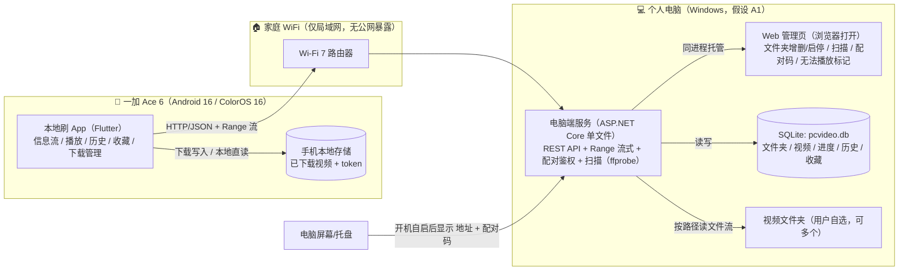
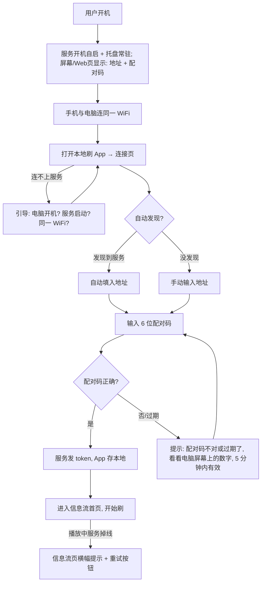

# 《本地刷》产品方案（PRD）

| 项    | 内容                         |
| ---- | -------------------------- |
| 文档版本 | v1.1（待评审）                  |
| 日期   | 2026-10-13                 |
| 作者   | 许清楚（产品经理）                  |
| 项目代号 | pcvideo                    |
| 产品名  | 本地刷                        |
| 状态   | 待评审（v1.1 已纳入用户对 Q1–Q3 的答复） |

| 版本   | 日期         | 修订人 | 说明                                                                                                                   |
| ---- | ---------- | --- | -------------------------------------------------------------------------------------------------------------------- |
| v1.0 | 2026-10-12 | 许清楚 | 初稿                                                                                                                   |
| v1.1 | 2026-10-13 | 许清楚 | 按用户答复更新：格式混杂事实化 + ffprobe 元数据决策；文件夹多选启停；电脑非 7x24（开机自启 + 托盘 + 离线引导）；收藏提前至 P1；片头片尾跳过明确不做；下载上限默认 10GB；新增「iOS / 网页端方案」章节 |

---

## 1. 项目启动信息

### 1.1 项目类型

个人自用工具类 App（非商业化产品）：**手机竖屏信息流播放器 + 电脑端局域网视频服务**。手机端像刷抖音一样上下滑动随机切换视频，视频来自用户电脑上「选中启用」的文件夹。

### 1.2 业务目标

1. **随手就刷**：在家连同一个 WiFi，打开手机 App 就能全屏刷本地视频，不用拷贝文件到手机。
2. **刷得舒服**：断点续播、倍速、锁屏后台播放、收藏、缓存下载，覆盖"躺着刷"的真实场景。
3. **电脑零负担上手**：电脑端服务开机自启 + 托盘常驻，Web 管理页小白可操作；用户是 C# 开发者，后续源码可自己维护。

### 1.3 成功标准（可判定）

| 编号 | 指标   | 判定标准                                                           |
| -- | ---- | -------------------------------------------------------------- |
| S1 | 首帧速度 | 局域网内（1080p mp4），从打开 App 到出现第一帧 ≤ 3 秒                           |
| S2 | 切换跟手 | 上下滑动切换视频，新视频 ≤ 500ms 起播（预加载生效时）                                |
| S3 | 续播准确 | 断点续播恢复位置与上次播放点误差 ≤ 2 秒                                         |
| S4 | 稳定   | 连续刷 30 分钟、含锁屏后台 10 分钟，无崩溃、无 ANR、后台播放声音不断                       |
| S5 | 交付完整 | 提供完整源码 + 可直接安装的签名 APK；用户按 README 10 分钟内完成「启动电脑服务 → 手机配对 → 开始刷」 |

### 1.4 范围定义

**In scope（本期做）**

- 手机 App：全屏竖屏信息流、上下滑动随机切换、自动连播、播放/暂停/进度条/时长
- 电脑端服务：自定义视频文件夹（增删、**多选启停**、扫描入库）、局域网访问、设备配对鉴权、Web 管理页
- 播放能力：基础播放 + 断点续播 + 播放历史；倍速（0.5x–2x）+ 后台/锁屏播放
- 收藏（P1 提前）：信息流收藏按钮 + 收藏列表页
- 本地下载缓存（默认上限 10GB，设置页可改）+ 下载管理页
- 服务不在线时的优雅引导（电脑非 7x24 的兜底）
- 适配一加 Ace 6（Android 16 / ColorOS 16，165Hz 高刷）

**Out of scope（本期不做，明确排除）**

- 公网访问 / 端口映射 / 任何互联网暴露（用户已确认仅家庭局域网）
- 服务端转码（默认直接播放原始文件；FFmpeg 无法解析的极少数格式标记"可能无法播放"，见 R1）
- **片头片尾跳过（用户 2026-10-13 明确不需要，不做）**
- 多用户账号体系、权限分级（个人单机单用户场景）
- 弹幕、字幕、投屏、TV 端
- iOS / 网页端本期不交付（方案见 §9；Flutter 代码随时可编 iOS）

### 1.5 终极功能定义（一句话可验证）

> 在一加 Ace 6 上安装 APK，与电脑连同一 WiFi，打开 App 即可全屏竖屏随机播放电脑上选中文件夹里的视频；支持断点续播、倍速、锁屏后台播放、收藏与本地缓存下载。

验收即这句话的每个分句都能当场演示通过。

### 1.6 技术约束

| 编号 | 约束                                                                                  | 来源    |
| -- | ----------------------------------------------------------------------------------- | ----- |
| C1 | 仅家庭同一 WiFi 局域网使用，不做公网暴露                                                             | 用户已确认 |
| C2 | 电脑端服务为自研（不复用现成 Web 服务）                                                              | 用户已确认 |
| C3 | App 必须适配一加 Ace 6：Android 16 / ColorOS 16、165Hz AMOLED、骁龙 8 Elite、Wi-Fi 7、7800mAh 电池 | 用户硬要求 |
| C4 | 交付物 = 完整源码 + 可直接安装的 APK                                                             | 用户要求  |
| C5 | 电脑运行环境假设为 Windows 10/11（依据用户主力环境推断，**假设**，需确认）                                      | 推断    |
| C6 | 视频源在本机磁盘（非网络共享盘，**假设**，需确认）                                                         | 推断    |
| C7 | 代码注释与 UI 文案用朴素小白口吻，不写广告腔                                                            | 用户要求  |
| C8 | 视频库格式混杂是既定事实（mkv/flv/avi/ts/wmv/mov/rmvb 等均可能有），播放器必须按"什么都能放"设计                     | 用户已确认 |

---

## 2. 需求池（P0/P1/P2）

> 优先级定义：**P0 = 没有它产品就不成立**；**P1 = 已确认要做的核心体验**；**P2 = 备选/后续**。每条需求给出可判定的验收标准。

### 2.1 P0（必须）

| 编号   | 需求                                                    | 验收标准                                                                                                                                            |
| ---- | ----------------------------------------------------- | ----------------------------------------------------------------------------------------------------------------------------------------------- |
| F-01 | 手机 App 全屏竖屏信息流：一屏一个视频，竖屏全屏播放                          | 在 Ace 6 上竖屏全屏显示，竖屏锁定，无异常黑边                                                                                                                      |
| F-02 | 上下滑动随机切换视频                                            | 连续滑动 20 次，每次都切换到不同视频，且均来自「已启用」文件夹                                                                                                               |
| F-03 | 自动连播                                                  | 任选一视频拖到片尾验证，3 秒内自动起播下一个                                                                                                                         |
| F-04 | 电脑端自定义视频文件夹：**增删 + 多选启停 + 扫描入库**（文件名、大小、时长、分辨率、编码、码率） | ① 添加文件夹后扫描出视频并带元数据；② 每个文件夹可单独启用/停用（默认全部启用），状态重启服务后保留；③ 随机池 = 启用文件夹的并集；④ App 文件夹管理页与电脑 Web 管理页均可改启停，两端显示一致；⑤ 删除文件夹后其视频不再出现（不删磁盘文件）；⑥ 重复添加同一路径有提示 |
| F-05 | 局域网访问与设备配对/鉴权                                         | 未配对设备请求 `/api/videos` 返回 401；配对成功后返回列表；token 持久化，重启 App 无需重新配对                                                                                  |
| F-06 | 基础播放控制：播放/暂停、进度条可拖动、显示时长与当前进度                         | 点击暂停立即定格静音；拖动进度条从对应位置继续；进度数字准确                                                                                                                  |
| F-07 | 流式传输支持 Range                                          | `curl -r 100-200` 请求 stream 接口返回 206 与正确字节段；拖动进度条不重新下载整个文件                                                                                      |

### 2.2 P1（应该，用户已确认）

| 编号   | 需求                                     | 验收标准                                                                                                                                                                                                 |
| ---- | -------------------------------------- | ---------------------------------------------------------------------------------------------------------------------------------------------------------------------------------------------------- |
| F-08 | 断点续播 + 长视频处理                           | ① 播放位置进度服务端存储，恢复误差 ≤ 2 秒（S3），换手机（重配对）也能恢复；② **「看完」判定：播放进度 ≥ 95% 标记 completed**；completed 的视频下次从 0 开始播放（重刷）；③ 续播**超长视频**（建议阈值 30 分钟，可调）时，控制层给出「继续看（从 mm:ss）/ 重头看」选择；交互细节（按钮样式、自动消失）由架构师/工程师定，此处锁定行为意图 |
| F-09 | 播放历史                                   | 播放后历史页有记录，按时间倒序；completed 的显示「看完」；点击任意一条跳到对应视频续播；可单条/全部删除                                                                                                                                            |
| F-10 | 倍速播放：0.5x / 1.0x / 1.25x / 1.5x / 2.0x | 播放中依次切换 5 档均生效且声音连续；倍速选择跨视频保持                                                                                                                                                                        |
| F-11 | 后台/锁屏播放                                | 锁屏 5 分钟音频不断；锁屏/通知栏可播放暂停、上一条/下一条；ColorOS 电池优化白名单引导（见 §8）                                                                                                                                              |
| F-12 | 本地下载缓存                                 | ① 下载管理页显示进度，支持暂停/恢复/删除；② 下载完成后断 WiFi 也能从信息流/历史播该视频；③ **默认缓存上限 10GB，设置页可改**，达到上限时暂停新下载并给出提示                                                                                                           |
| F-13 | 收藏（从 P2 提前）                            | ① 信息流控制层有收藏按钮，可收藏/取消；② 收藏列表页展示全部收藏，可取消收藏、点击续播；③「稍后再看」与收藏合并为一个概念、一个列表（数据模型已预留字段，后续要区分再加）；④ 服务重启后收藏保留                                                                                                  |
| F-20 | 服务不在线时的优雅引导                            | ① 电脑关机/睡眠/服务未启动时，连接页和信息流页 3 秒内显示小白引导文案（检查：电脑是否开机、服务是否启动、是否同一 WiFi）与重试入口；② 服务恢复后点重试即可继续，无需重新配对                                                                                                        |

### 2.3 P2（备选，后续排期）

| 编号   | 需求                     | 说明                                                            |
| ---- | ---------------------- | ------------------------------------------------------------- |
| F-14 | 按文件夹筛选/浏览              | **部分提前**：文件夹「启停开关」已并入 F-04（P1），随机池=启用并集；其余（如浏览页按文件夹查看列表）维持 P2 |
| F-15 | 搜索（按文件名）               | 依赖电脑端索引                                                       |
| F-16 | 排序方式切换（最新添加 / 名称 / 时长） | 与随机策略互斥或组合，需设计                                                |
| F-17 | 缩略图预览                  | 列表态预览图；电脑端可缓存首帧截图                                             |
| F-18 | 片头片尾跳过                 | **明确不做**（用户 2026-10-13 确认不需要）                                 |
| F-19 | iOS / 网页端              | 方案见 §9；Flutter 代码随时可编 iOS 包，本期只交付 Android                     |

---

## 3. 用户故事

| 编号    | 用户故事                                                  | 对应需求           |
| ----- | ----------------------------------------------------- | -------------- |
| US-01 | 作为用户，我想躺在床上一屏一屏刷电脑里的视频，像刷抖音一样上下滑，这样不用坐在电脑前也能看         | F-01/F-02/F-03 |
| US-02 | 作为用户，我想勾选哪几个文件夹参与随机刷、随时启停，这样我能控制片源范围，不用把所有视频拷到手机      | F-04           |
| US-03 | 作为用户，我想第一次配对之后以后打开就能直接刷，这样不用每次输地址输密码                  | F-05           |
| US-04 | 作为用户，我想上次看到一半的视频下次接着看，这样不重复看开头；几个小时的長视频也要能记住看到哪       | F-08           |
| US-05 | 作为用户，我想锁屏放着听声音、在通知栏暂停切歌，这样洗碗/通勤时不亮屏也能用                | F-11           |
| US-06 | 作为用户，我想没看完的下载到手机、在地铁上离线看，这样不耗流量也不怕 WiFi 断             | F-12           |
| US-07 | 作为用户，我想拖进度条、开二倍速，这样能快进废话、慢放细节                         | F-06/F-10      |
| US-08 | 作为用户，我想在历史里找回昨天看过的那集，从中间接着看，这样不用凭记忆翻                  | F-09           |
| US-09 | 作为用户，想把刷到喜欢的视频点个收藏，之后在收藏列表里找回来看，这样好视频不刷丢              | F-13           |
| US-10 | 作为用户，电脑睡着了/关机时想让 App 明说"现在连不上、检查哪几样"，而不是一直转圈，这样我知道该干嘛 | F-20           |

---

## 4. 技术选型建议（含取舍）

> 原则：先列候选与权衡，再给选择；不确定的事实标注为**假设**。

### 4.1 App 框架

| 维度               | Flutter                          | 原生 Kotlin                        | React Native      |
| ---------------- | -------------------------------- | -------------------------------- | ----------------- |
| Android+iOS 一套代码 | ✅ 支持（用户提到 iOS 将来也行，见 §9）         | ❌ 需重写                            | ✅ 支持              |
| 竖屏信息流生态          | ✅ 成熟（PageView + 预加载，TikTok 式轮子多） | ⚠️ 手写 ViewPager2，可控但工作量在 UI 层    | ⚠️ 一般，长列表视频性能调优麻烦 |
| 后台/锁屏播放          | ✅ media_kit 有成熟方案                | ✅ ExoPlayer + MediaSession 最原生最稳 | ⚠️ 桥接坑多           |
| 165Hz 高刷适配       | ✅ 默认跟随系统，可插件强制高刷                 | ✅ 原生 API 直接控制                    | ⚠️ 需桥接            |
| 用户学习成本           | Dart 语法与 C#/Java 近似，低            | 用户主力 C#，需学 Kotlin/Android 全家桶    | 需学 JS/TS 生态       |
| APK 体积           | 偏大（+播放内核后更大）                     | 最小                               | 中                 |

**选择：Flutter。**  
理由：① 用户明确 iOS 将来也可能要，Flutter 一份代码覆盖；② 竖屏滑动信息流是该生态最成熟的场景之一，原型到成品路径短；③ Dart 与 C# 相似，.NET 背景迁移成本低。  
反选 Kotlin 的理由与撤销条件：若确认只做 Android 且锁屏后台播放稳定性是最高优先级，原生 Kotlin + ExoPlayer 的系统集成深度更好——**撤销条件：用户明确放弃 iOS、且遇到 Flutter 后台播放无法稳定修复的阻塞性 bug**。  
反选 React Native 的理由：视频信息流性能与播放器生态均非其强项，无突出收益。

### 4.2 播放内核（Flutter 生态）

| 维度      | video_player                                           | chewie         | better_player  | media_kit (libmpv)                                                          |
| ------- | ------------------------------------------------------ | -------------- | -------------- | --------------------------------------------------------------------------- |
| 格式兼容    | ExoPlayer：mp4/h264/aac 好；**用户片库格式混杂（已确认）**，DTS/部分容器不支持 | 同 video_player | 同 ExoPlayer    | libmpv+FFmpeg：覆盖最全——mkv/flv/avi/ts/wmv/mov/rmvb 可软解，HEVC/AV1、DTS/EAC3 音轨可软解 |
| 倍速      | 需自行封装                                                  | 部分版本支持         | 支持             | 支持                                                                          |
| 后台/锁屏音频 | ❌                                                      | ❌              | ⚠️ 有限          | ✅ 有 audio 模式 + 媒体通知集成                                                       |
| 缓存      | ❌                                                      | ❌              | ✅ 但偏 HLS 场景    | 自行下载管理（本方案下载走文件下载，不走播放器缓存）                                                  |
| 维护状态    | 官方，稳定但功能少                                              | 社区，一般          | 维护放缓（**观察结论**） | 活跃                                                                          |
| 包体增量    | 小                                                      | 小              | 中              | 大（约 +20–40MB，**估算**）                                                        |

**选择：media_kit（libmpv）——v1.1 维持。**  
理由：用户已确认格式混杂「什么类型都有」，libmpv 的 FFmpeg 系软解是四个候选里唯一能对 mkv/flv/avi/ts/wmv/mov/rmvb 及 DTS/EAC3 音轨都说"能放"的；倍速、后台音频同时满足；维护活跃。  
兜底：极少数 FFmpeg 也无法解析的格式，扫描时标记「可能无法播放」并在 Web 管理页提示（见 F-04、R1），不做转码。  
反选 better_player 的理由与撤销条件：若片库收敛为纯 mp4/h264+aac 且接受其后台播放局限，可换 better_player 减小包体——**撤销条件：media_kit 在 Ace 6 上出现无法修复的硬解/兼容问题，或用户明确只放 mp4 且在意包体**。

### 4.3 电脑端服务

| 维度       | ASP.NET Core 8/9（LTS）                             | Go           |
| -------- | ------------------------------------------------- | ------------ |
| 语言熟悉度    | ✅ 用户主力 C#，可直接维护                                   | 需从零学         |
| 发布形态     | 自包含单文件（约 60–80MB，**估算**），双击即用                     | 单二进制 10–15MB |
| Range 支持 | ✅ 框架级 `PhysicalFile(enableRangeProcessing: true)` | 需手写或用第三方库    |
| 数据库访问    | EF Core + SQLite，用户熟悉 ORM 套路                      | 需学 Go 生态     |
| 跨平台      | ✅（将来可搬 Linux/NAS）                                 | ✅            |
| 常驻内存     | 相对高（**估算** 100MB 上下）                              | 低（20MB 上下）   |

**选择：ASP.NET Core（自包含单文件发布）+ SQLite（EF Core）。**  
理由：① 用户是 .NET 开发者，源码可读可改可扩展，这是个人工具长期存活的关键；② Range、静态文件、最小 Web API 全是框架原生能力，开发最快；③ SQLite 零部署，EF Core 用户有 SQL Server 经验可平滑迁移概念。  
反选 Go 的理由与撤销条件：Go 二进制小、内存省——**撤销条件：用户要求把服务部署到 NAS/树莓派等小内存常开设备，且愿意接受学习 Go 或届时再评估**。  
数据库选 SQLite：单文件、随服务拷贝、备份就是拷一个文件；个人数据量（数千至万级视频元数据）远未到 SQL Server 级别，引入 SQL Server 反而违背"小白一键启动"目标。

### 4.4 其他关键决定

| 决定                  | 选择                                   | 理由                                                           | 反选/撤销条件                                                                 |
| ------------------- | ------------------------------------ | ------------------------------------------------------------ | ----------------------------------------------------------------------- |
| 元数据扫描（时长/分辨率/编码/码率） | **随包分发 ffprobe.exe 静态构建**，扫描时调用      | .NET 无内置等价能力，ffprobe 是事实标准；随包分发保证小白零安装；进度条总时长、长视频提示、列表信息都依赖它 | 若放弃时长显示（只用文件名+大小）可去掉，但播放体验明显降级；**具体调用方式/并发策略由架构师定，此处锁定决策与理由**           |
| 服务常驻方式              | **开机自启 + 托盘常驻（可关闭）**                 | 用户确认电脑非 7x24；自启+托盘让"打开电脑就能刷"成本最低；托盘可手动退出                     | 用户改主意要 7x24 也兼容（自启保留即可）；若讨厌托盘，提供纯后台模式选项（P2）                             |
| 转码                  | **不做**（直接播放原始文件）                     | 个人工具先求简单；libmpv 已覆盖绝大多数格式                                    | FFmpeg 也无法解析的格式标记「可能无法播放」；若这类文件很多且用户确实要刷，再评估 ffmpeg 按需转码（工作量显著上升，需重新排期） |
| 设备发现                | 手动输入 IP:端口为主 + 局域网广播/mDNS 自动发现为辅（P1） | 手动最可靠零魔法；mDNS 在部分路由器/ColorOS 上不稳定（**经验性风险**）                 | mDNS 若在用户路由器不可用，纯手动输入也可用（电脑端把地址和配对码放大显示；README 建议路由器给电脑绑定固定 IP）         |
| 鉴权                  | 6 位配对码换 token（`X-Api-Token` 头）       | 局域网低威胁场景，防误连（客人连错 WiFi）足够，不引入账号体系                            | 若将来要多设备管理/撤销设备，再加设备列表与 token 生命周期管理                                     |
| 下载实现                | 复用 `/stream` 的 Range 能力做客户端断点下载      | 服务端零新增接口；下载暂停/恢复 = Range 续传                                  | 若后续要服务端统一下载队列，再拆独立接口                                                    |

---

## 5. 系统组成与数据流



数据流说明：

1. **配对**：服务开机自启 → 屏幕/Web 页显示配对码 → App 输入 → 换 token 存手机本地。
2. **浏览与收藏**：App 调 `/api/videos/random`（带 folderIds，不传则取全部启用文件夹）拿一批随机视频 → 本地洗牌袋播放；收藏走 `PUT /api/videos/{id}/favorite`。
3. **播放与进度**：App 调 `/api/videos/{id}/stream`（带 Range）→ 服务读磁盘文件流式返回；播放进度约每 10s `PUT /api/videos/{id}/progress`，≥95% 标记 completed。
4. **下载**：App 用同一 stream 接口分段断点下载到手机存储（默认上限 10GB）；下载完成的视频走本地文件播放，不请求服务。
5. **管理**：用户在电脑浏览器打开 Web 管理页，增删/启停文件夹、触发扫描（ffprobe 取时长/分辨率/编码/码率，FFmpeg 无法解析的标记「可能无法播放」）、看配对码。
6. **离线兜底**：电脑睡眠/关机/服务未启时，App 连接页与信息流页显示引导文案与重试入口（F-20）。

---

## 6. 接口契约草案（概要级）

> 鉴权：除配对接口外，所有请求带 `X-Api-Token` 头；无效返回 401。以下为概要，不写完整 OpenAPI。

| 方法与路径                                                   | 作用                    | 关键参数 / 返回                                                                      |
| ------------------------------------------------------- | --------------------- | ------------------------------------------------------------------------------ |
| `POST /api/pair`                                        | 配对换 token             | 入参 `{code}`；返回 `{token, serverName}`                                           |
| `GET /api/server/info`                                  | 连接页展示服务信息             | 返回 `{serverName, version, videoCount, folderCount}`                            |
| `GET /api/folders`                                      | 文件夹列表（含启停状态）          | 返回 `[{id, name, path, enabled, videoCount, lastScanAt}]`                       |
| `POST /api/folders`                                     | 添加文件夹                 | 入参 `{path, name?}`；enabled 默认 true；重复路径返回 409                                  |
| `DELETE /api/folders/{id}`                              | 删除文件夹（不删磁盘文件，仅解除管理）   | 204                                                                            |
| `PUT /api/folders/{id}/enabled`                         | 启用/停用文件夹              | 入参 `{enabled}`；随机池口径随之变化                                                       |
| `POST /api/folders/{id}/scan`                           | 触发扫描入库（含 ffprobe 元数据） | 返回 `{found, added, removed, unplayable, status}`                               |
| `GET /api/videos`                                       | 视频分页列表（管理/历史跳转用）      | 查询 `folderId, enabledOnly, cursor, limit=20`；返回 `{items, nextCursor}`          |
| `GET /api/videos/random`                                | 随机批量（信息流专用）           | 查询 `limit=20&folderIds=逗号分隔&exclude=最近播放id`；不传 folderIds 时取全部启用文件夹             |
| `GET /api/videos/{id}/stream`                           | 流式播放 / 下载（同一接口）       | 支持 Range，返回 206；Content-Type 按扩展名                                              |
| `GET /api/videos/{id}/progress`                         | 查某视频续播点               | 返回 `{positionSec, durationSec, completed}`                                     |
| `PUT /api/videos/{id}/progress`                         | 上报/更新播放进度             | 入参 `{positionSec, durationSec, completed}`；播放中约每 10s 调一次；≥95% 由服务端判定 completed |
| `GET /api/history`                                      | 播放历史                  | 查询 `cursor, limit=50`；按时间倒序                                                    |
| `DELETE /api/history/{videoId}` / `DELETE /api/history` | 删单条 / 清空历史            | 204                                                                            |
| `PUT /api/videos/{id}/favorite`                         | 收藏/取消收藏               | 入参 `{isFavorite}`                                                              |
| `GET /api/favorites`                                    | 收藏列表                  | 查询 `cursor, limit`；返回同 `/api/videos` 结构                                        |
| `GET/PUT /api/settings`                                 | 服务端默认设置（默认倍速、自动连播等）   | P1                                                                             |
| `GET /api/videos/{id}/thumbnail`                        | 缩略图（P2，F-17）          | 返回 jpg                                                                         |
| `GET /`                                                 | Web 管理页（同进程托管静态页）     | 文件夹增删/启停 / 扫描 / 配对码 / 无法播放标记 / 服务状态                                            |


一致性说明：

- 下载（F-12）复用 `GET /api/videos/{id}/stream` + Range，不新增下载接口。
- 进度（F-08）与历史（F-09）共用同一张进度表，历史页即进度表按时间倒序投影。
- 收藏（F-13）存 SQLite，「稍后再看」不建第二张表。
- **随机池口径唯一**：文件夹启停状态只存 SQLite 一份，App 与 Web 管理页都读写同一份，避免两端不一致。

---

## 7. UI 结构与交互流程

### 7.1 页面清单

| 页面           | 内容                                                                                               | 优先级 |
| ------------ | ------------------------------------------------------------------------------------------------ | --- |
| ① 连接/配对页     | 输入电脑地址（IP:端口）→ 输入 6 位配对码 → 保存 token；**连不上时显示三项检查引导**（电脑开机？服务启动？同一 WiFi？）                         | P0  |
| ② 信息流首页（播放页） | 全屏竖屏视频；上下滑切换；点击屏幕显隐控制层（播放/暂停、进度条、时长、倍速、**收藏按钮**、下载按钮）；自动连播；**续播超长视频时显示「继续看/重头看」**；服务掉线时顶部横幅 + 重试 | P0  |
| ③ 播放历史页      | 历史列表（文件名 + 进度 + 时间，completed 显示「看完」）；点击续播；单条/全部删除                                                | P1  |
| ④ 文件夹管理页     | 展示电脑端已添加文件夹与视频数，**每个文件夹带启停开关（默认全部启用）**；添加/删除文件夹引导去电脑 Web 页                                       | P0  |
| ⑤ 下载管理页      | 下载中 / 已完成分栏；进度条；暂停/恢复/删除；缓存总大小与上限（默认 10GB）                                                       | P1  |
| ⑥ 收藏列表页      | 收藏的视频列表；点击续播；可取消收藏；空态引导去信息流点心形按钮                                                                 | P1  |
| ⑦ 设置页        | 服务器连接信息与重配对；默认倍速；自动连播开关；缓存上限设置与清理；「刷哪些文件夹」入口（跳④）；关于                                              | P1  |

信息流首页线框（文字）：

```
┌─────────────────┐
│      （视频全屏）      │  ← 上滑：上一个随机视频
│                         │     下滑：下一个随机视频
│   点击屏幕 → 显示/隐藏控制层  │
│                         │
│  ▶/⏸   ──●────  03:15/08:40  │  ← 控制层：播放暂停 + 进度条 + 时长
│  [1.0x] [♡ 收藏] [⬇ 下载] [⋯] │  ← 倍速 / 收藏 / 下载 / 更多（预留）
└─────────────────┘
```

长视频提示示意（续播 ≥30 分钟视频时，控制层下方弹出）：

```
┌──────────────────────────────┐
│ 这个视频有点长（1 小时 23 分）        │
│  [ 继续看 12:34 ]   [ 重头看 ]   │
└──────────────────────────────┘
```

文案风格示例（小白口吻，全 App 遵守）：

- 配对页标题：「连一下你的电脑」；提示：「电脑和手机要连同一个 WiFi。打开电脑上的"本地刷服务"，把屏幕上那 6 位数字填进来。」
- 连接页连不上：「连不上电脑。挨个看看：① 电脑开机了吗？② 电脑上的"本地刷服务"启动了吗（启动后屏幕上会显示地址和配对码）？③ 手机和电脑连的是同一个 WiFi 吗？」
- 信息流页掉线横幅：「电脑睡着了或服务没开，刷不了了。检查好后点"重试"。」
- 收藏列表空态：「还没有收藏。刷到喜欢的视频，点一下 ♡ 就进这里了。」

### 7.2 关键流程一：首次连接配对



### 7.3 关键流程二：滑动随机策略

- **随机池口径**：只刷「已启用」文件夹的视频（启用并集），默认全部启用；启停可在 App ④ 文件夹管理页或电脑 Web 管理页修改，两端同源（SQLite）。
- **客户端洗牌袋**：进入 App 时请求 `GET /api/videos/random?limit=20&folderIds=启用文件夹&exclude=最近播放id`，本地打乱成播放袋；依次播放，播到剩 5 个时静默预取下一袋。
- **不重复保证**：请求时排除最近播放过的 N 个 id（N=10，**假设值**，可设置调整）；袋内天然不重复；跨袋允许少量重复（随机刷的预期行为）。
- **小片库退化**：池内视频 < 20 时退化为「全量洗牌循环播」。
- **预加载**：滑动切换前预加载下一视频首段，保证 S2 的 ≤500ms 起播。
- **大库性能**：服务端 `ORDER BY RANDOM()` 在万级以内可接受（**假设**，见 R2），超出后改随机 id 区间取样。

---

## 8. 适配与兼容要点（一加 Ace 6 / Android 16 / ColorOS 16）

| 主题          | 要点                                                                                                                                                                            |
| ----------- | ----------------------------------------------------------------------------------------------------------------------------------------------------------------------------- |
| 后台播放保活      | 以前台服务（foreground service，类型 `mediaPlayback`）+ MediaSession 通知运行；ColorOS 16 电池优化可能杀后台，App 内置引导页：图文引导用户把「本地刷」加入电池优化白名单 / 允许后台运行（ColorOS 设置项名称随版本变化，文案给手动路径，deep link 失败则退回手动指引） |
| 锁屏控制        | 锁屏通知与锁屏界面提供播放/暂停、上一条/下一条；media_kit 的音频模式 + 媒体通知集成实现                                                                                                                           |
| 165Hz 高刷    | Flutter 默认跟随系统刷新率；滑动动画用 PageView + 预加载，避免主线程重构建；可用 `flutter_displaymode` 类插件显式请求高刷档位（P1 验证项）；验收：滑动过程用开发者选项帧率监测无持续掉帧                                                           |
| Wi-Fi 7 局域网 | 手机与电脑尽量同频段（5G/6G，**建议**）；电脑服务绑定 `0.0.0.0`；Windows 防火墙首次弹窗需放行（README 写清楚）；README 建议路由器给电脑绑定固定 IP，免得不定期换地址要重新配对                                                                 |
| 混合码率/分辨率缓冲  | 片库分辨率与码率混杂（已确认）：播放器缓冲策略按「**起播快、抗波动**」调优——起播用小缓冲求快，播放中动态扩容抗网络波动；弱 WiFi 场景不允许无限转圈，最差给出明确错误与重试（呼应 F-20）                                                                          |
| 电池与发热       | 7800mAh 电池对连续播放友好；仍按「省电模式可能降帧/杀后台」写引导；长播放发热监测列入联调                                                                                                                             |
| APK 安装      | 交付自签名 release APK；引导开启「安装未知应用」权限（对来源应用：浏览器/文件管理器）；README 附 `adb install` 备选；targetSdk 对齐 Android 16（API 36），遵循前台服务类型声明与通知权限（POST_NOTIFICATIONS）                               |
| 分屏/小窗       | P2 不做；ColorOS 小窗下竖屏全屏布局降级为可接受即可，不专门适配                                                                                                                                         |

---

## 9. iOS / 网页端方案（未来，本期不交付）

**结论先行：本期只交付 Android APK。** 由于 App 选型 Flutter，iOS 用同一代码库、服务端零改动；安装方式等真需要时再选。

### 9.1 为什么服务端零改动

- 电脑端服务是纯 HTTP API（§6），iOS App 直接复用全部接口，服务不用改一行。
- 播放内核 media_kit 跨平台，iOS 同样可用；收藏、进度、历史逻辑与 UI 均复用。

### 9.2 三条安装路径对比

| 路径                            | 费用    | 签名有效期   | 限制                                                   | 适用     |
| ----------------------------- | ----- | ------- | ---------------------------------------------------- | ------ |
| ① 免费 Apple ID + Sideloadly 侧载 | 免费    | 7 天     | 免费账号同时最多 3 个侧载 App；Sideloadly 后台守护进程可在电脑同 WiFi 时自动续签 | 自用、偶尔用 |
| ② $99/年 苹果开发者账号               | $99/年 | 1 年     | 可发 TestFlight 内测（本场景仅自己）                             | 长期自用   |
| ③ PWA 网页版                     | 免费    | 随服务在线即用 | iPhone Safari 打开即刷、零安装；全屏播放/锁屏音频/滑动流畅度不如原生           | 临时尝鲜   |

注意：路径 ③ 不是纯零工作量——需要基于同一套 API 额外开发一个网页版信息流页面，工作量小于原生 App 但大于"什么都不做"。

### 9.3 iOS 端差异注意

- 后台音频与锁屏控制：media_kit 同样支持（与 Android 一致）。
- 画中画（PiP）：iOS 支持较好，可补偿 Android 端 P2 不做小窗的缺憾。
- 下载文件位于 iOS App 沙盒内，不越狱不能像 Android 那样直接导出文件；管理界面与 Android 下载页一致。
- 路径 ① 的续签依赖「电脑开机 + 同一 WiFi」——与「电脑非 7x24」叠加时免费路径体验打折，这是路径 ② 的主要动机。
- **构建环境**：iOS 包必须用 macOS + Xcode 编译，用户现役 Windows 无法直接出 iOS 包（**假设 A9**：真需要时有 Mac 可用，或借/租一台，或届时再评估）。Flutter 工程本身不设平台壁垒。

### 9.4 结论

- 本期：只交付 Android；Flutter 工程按「随时可编 iOS」维护，Wave 5 做代码就绪度检查（无 Android 专有硬编码、依赖无平台锁死），实际编译留到有 Mac 时。
- 未来真需要 iPhone 刷：先用路径 ① 试用，长期用转路径 ②；路径 ③ 仅在临时场景考虑。

---

## 10. 风险与待确认问题

### 10.1 风险

| 编号 | 风险                                                                                              | 影响                               | 应对                                                                                |
| -- | ----------------------------------------------------------------------------------------------- | -------------------------------- | --------------------------------------------------------------------------------- |
| R1 | 视频格式混杂是既定事实（mkv/flv/avi/ts/wmv/mov/rmvb、HEVC/AV1、DTS/EAC3 均可能有），仍有极少数 FFmpeg 无法解析的格式；4K 高码率可能卡顿 | 播放成功率与流畅度                        | libmpv 覆盖绝大多数；扫描时对无法解析的文件标记「可能无法播放」并在 Web 管理页提示；仍不行再评估按需转码（重新排期）                  |
| R2 | 视频数量「很多」（用户答复），但具体量级未明                                                                          | 影响随机接口性能、分页、缩略图加载                | 按万级设计（cursor 分页、随机 exclude 上限、`ORDER BY RANDOM()` 万级内可接受）；联调用真实片库实测，超量改随机 id 区间取样 |
| R3 | 电脑非 7x24（睡眠/关机）已确认                                                                              | 刷到一半断、打开连不上                      | 开机自启 + 托盘常驻；App 离线引导（F-20）；Wake-on-LAN 维持 P2                                      |
| R4 | 文件夹权限/路径未知（服务以哪个 Windows 身份读盘、是否含外接盘/网络盘）                                                       | 扫描失败或流式读取失败                      | Web 管理页扫描时明确报错原因（路径不存在/无权限）；支持多盘符                                                 |
| R5 | ColorOS 版本差异大，杀后台策略因机型/系统版本而异                                                                   | 后台播放被杀的抱怨                        | 引导页 + 验收时在 Ace 6 实测；接受「引导后仍可能被杀」的客观限制并在 README 说明                                 |
| R6 | media_kit 包体增量（+20–40MB，**估算**）与首次集成复杂度                                                         | 构建时间/APK 体积                      | 提前在 Wave 1 做技术 spike 验证                                                           |
| R7 | 时长跨度极大（几秒到几小时）                                                                                  | 超长视频的进度上报频率、续播误差、缓存占用；几秒短视频的连播体验 | 进度按时间+事件双触发上报；超长视频提示「继续看/重头看」（F-08）；下载上限 10GB 默认兜底                                |

### 10.2 待确认问题（Q1–Q3 已答复，转为决策记录）

| 编号 | 原问题            | 状态    | 结论（已落入文档）                                                                         |
| -- | -------------- | ----- | --------------------------------------------------------------------------------- |
| Q1 | 视频数量与格式        | ✅ 已答复 | 格式混杂既定事实 → libmpv + ffprobe 覆盖 + 无法解析标记（§4.2/§4.4/R1）；数量「很多」量级未明 → 按万级设计、联调实测（R2） |
| Q2 | 混播/单文件夹 + 电脑睡眠 | ✅ 已答复 | 用户自选启用文件夹并集随机（F-04/§7.3）；电脑非 7x24 → 开机自启 + 托盘 + 离线引导，WoL 维持 P2（§4.4/F-20）         |
| Q3 | P1/P2 边界 + iOS | ✅ 已答复 | 收藏提前 P1、稍后再看与收藏合并（F-13）；片头片尾跳过明确不做（F-18）；iOS 方案见 §9，本期不交付                         |

**v1.1 新增待确认（小项，不阻塞开工）**：

1. 视频库具体量级（几十/几百/几千/上万）？影响随机性能实测目标（R2）。
2. 超长视频提示阈值 30 分钟、「看完后从 0 重播」规则，是否符合你的习惯？
3. 下载上限默认 10GB 是否合适（Ace 6 存储余量未知）？

---

## 11. 里程碑草案（Wave 思路）

| 阶段                        | 内容                                                                                                                                                                       | 可验证的完成标准                                                                                                                             |
| ------------------------- | ------------------------------------------------------------------------------------------------------------------------------------------------------------------------ | ------------------------------------------------------------------------------------------------------------------------------------ |
| **Wave 1：环境 + 电脑端服务**     | ASP.NET Core 单文件服务、SQLite+EF Core、文件夹增删/启停、**ffprobe.exe 随包分发**的扫描（时长/分辨率/编码/码率，无法解析的标记「可能无法播放」）、Range 流式播放接口、配对鉴权、Web 管理页（文件夹管理/启停/扫描/配对码/无法播放标记）、**开机自启 + 托盘常驻**       | ① `curl` 带 Range 请求返回 206 正确字节；② 浏览器打开管理页能加文件夹并扫描出带时长的视频；③ 未带 token 请求返回 401；④ 服务双击即启动、无需装 .NET 运行时；⑤ 重启电脑后服务自动起来；⑥ 乱格式文件被标记「可能无法播放」 |
| **Wave 2：App 骨架 + 信息流播放** | Flutter 工程、media_kit 集成 spike、连接配对页、全屏竖屏信息流、随机切换（folderIds 启用并集）、自动连播、基础控制条、混合码率缓冲初步调优、**离线引导初版**                                                                        | ① APK 装到 Ace 6；② 配对成功后连续刷 20 个视频不崩不黑屏；③ 随机池只含启用文件夹（停一个文件夹验证）；④ 暂停/进度条/时长正常；⑤ 滑动切换 ≤500ms 起播（S2 抽测）；⑥ 电脑关机时连接页出现三项检查引导                |
| **Wave 3：P1 播放体验**        | 断点续播（≥95% 看完规则、超长视频「继续看/重头看」提示）、播放历史页（看完标记）、倍速 5 档、锁屏后台播放 + 通知控制、ColorOS 电池优化引导、**收藏（按钮 + 列表页 + 取消）**、离线引导完善                                                             | ① 续播误差 ≤2 秒（S3）；② ≥95% 标「看完」且下次从 0 播放；③ 锁屏 5 分钟音频不断且可通知栏控制；④ 收藏/取消/列表续播全流程通过；⑤ 电脑睡眠后 App 引导文案可演示、恢复后重试可用                             |
| **Wave 4：下载缓存**           | 基于 Range 的断点下载、下载管理页（进度/暂停/恢复/删除）、本地文件直播、缓存清理、**10GB 默认上限（设置页可改）**                                                                                                       | ① 下载-暂停-恢复-删除全流程通过；② 下载完成后飞行模式可播；③ 设置页显示缓存大小、可改上限、可清理；④ 达到上限时暂停新下载并提示                                                                |
| **Wave 5：联调 + 适配调优 + 交付** | 165Hz 滑动流畅度调优、弱 WiFi 缓冲（抗不卡死）、万级视频库随机性能实测、边界与异常处理、源码整理（小白口吻注释）、README（含固定 IP 建议、Windows 防火墙放行、APK 未知来源安装、ColorOS 白名单）、签名 APK、**iOS 代码就绪度检查（Windows 无法编 iOS 包，仅确认无平台锁死）** | ① 连续刷 30 分钟无崩溃无 ANR（S4）；② 用户按 README 10 分钟内完成启动→配对→播放（S5）；③ 交付源码 + 可安装 APK；④ iOS 就绪度检查记录在案                                           |

---

## 附：本文档中的假设清单（汇总）

- A1：电脑*为 Windows 10/11，视频在本机磁盘（非共享盘）*。（未再确认）
- A2：格式混杂为既定事实（用户答复）；含 ffprobe/FFmpeg 无法解析的极少数格式，按「标记可能无法播放」处理。
- A3：视频数量「很多」，具体量级未明；按万级设计分页与随机，联调实测。
- A4：已确认：随机池 = 用户启用的文件夹并集，默认全部启用。
- A5：个人单用户、单手机使用，无多设备并发管理需求。
- A6：局域网低威胁，配对码 + token 足够，不做账号体系。
- A7：下载缓存默认上限 10GB，设置页可改（用户确认默认值）。
- A8：服务默认开机自启 + 托盘常驻，可关闭（用户确认）。
- A9：iOS 构建需 macOS/Xcode；现役 Windows 无法直接编 iOS 包，真需要时有 Mac 可用。

> 以上假设如有不符，请在评审时指出，按 §10.2 问题清单优先级修订。
